# The scenes

There are 65 built-in scenes: 14 general scenes, the original ten among them, which also show while
a build passes, 27 pass scenes made for a passing build and 24 fail scenes made for a failing one,
the storm among them.
`zacess-scenes list` marks each one pass, fail or general. Each section starts with a still from the
gallery, drawn by `zacess-scenes snapshot` in Zacess Deep Contrast Dark at 80 by 24, six seconds in.

What each scene draws, how it fits the screen, which of the theme's colours it uses and what
changes under reduced motion. Every scene implements the `Scene` trait in `src/scene.rs` and lives
in its own file under `src/scenes`.

## At a glance

### The original scenes

| Scene | What it shows | Under reduced motion |
| --- | --- | --- |
| `sea` | Fish of three sizes, bubbles, seaweed on a sandy bed, a boat on the surface and, now and then, a whale crossing the deep water under a sky that warms to the horizon | Everything swims at half speed, fewer bubbles rise and the highlights on the water are fewer and slower |
| `rain` | Rain at three depths on a wet evening street under drifting cloud, with lit windows, street lamps mirrored in the road, puddles ringing, someone walking under an umbrella and a distant bolt of lightning every few seconds at most | No lightning at all; the rain, the cloud and the walker move at half speed |
| `snow` | Flakes at three depths drifting down over two lines of hills with snowy pines, settling into a bank along the bottom. A winter night on dark themes and a snowy day on light ones | Flakes fall and sway at half speed |
| `starfield` | Stars that brighten and fade slowly over a faint band of the galaxy and two low lines of hills, a crescent moon and now and then a slow shooting star. On light themes the same sky at dawn with the last few stars | Stars take twice as long to change, shooting stars are rarer and slower |
| `code-rain` | Columns of characters falling in the theme's syntax colours, each with a bright head and a tail that fades away | Columns fall at most three rows a second and their characters are never swapped |
| `fireflies` | A meadow at dusk under a moon, with hills, a line of trees, one great tree and long swaying grass, where lights drift and pulse slowly. On light themes a summer afternoon with a sun, clouds, wild flowers, butterflies and drifting pollen | Pulses take at least twice as long, the lights wander at under half the speed and the grass sways at half speed |
| `aurora` | Two or three slow curtains of colour across the upper sky over a ridge of snow-capped peaks, a starry night on dark themes and the blue hour on light ones | The curtains drift and breathe at half speed |
| `campfire` | A campfire in a clearing ringed by pines, flames whose rows take a new shape one at a time, each at most once every 0.6 seconds, over logs on a bed of coals inside a ring of stones, with rising embers and a steady glow | Each row changes at most once every 1.5 seconds, fewer and slower embers |
| `waves` | A calm sea to the horizon under a sun, with gulls crossing the sky | Slower swell and slower wing beats |
| `zacess` | The Zacess mark at about half the screen's height, floating slowly round the middle over a soft wash with two ribbons of colour flowing across it | The mark floats and the ribbons flow at half speed |

### More general scenes

Calm general scenes drawn in solid pixels, like `sea`.

| Scene | What it shows | Under reduced motion |
| --- | --- | --- |
| `forest-stream` | A stream winding through a forest towards the viewer, trunks at three depths under the canopy, shafts of light drifting slowly across them, ripples flowing downstream, leaves riding the current, stones and ferns on the banks and motes of dust in the light | The water, the leaves, the light and the motes move at half speed |
| `desert-night` | Dunes in three ranges under a starry sky, a moon rising over a few minutes and then holding, a caravan of camels on the far ridge, a cactus and now and then a slow shooting star; at sunrise in light themes, with a pale sun over golden dunes and no stars | Stars change half as often, the moon and the camels move at half speed and there are no shooting stars |
| `rooftops` | Rooftops at dusk from a high window: a far skyline, a terrace whose windows light up and go dark one at a time, then near slate roofs with chimney stacks, smoke, aerials and pigeons on the ridges, one now and then flying to another roof; late afternoon in light themes | Windows change half as often and the smoke, the clouds and the pigeons move at half speed |
| `lily-pads` | A pond seen from above with lily pads and a few water lilies, frogs that hop from pad to pad now and then with rings of ripples and dragonflies darting between hovers | Frogs hop half as often, the ripples and the light on the water move at half speed and the dragonflies dart more slowly still |

### Pass scenes

Calm scenes made for a passing build: nature, the city, space, water, the seasons, cosy rooms,
two abstract pieces in the Zacess style and five pieces of work going right (a drone landing, a
kettle boiling, a rocket launch, a pit stop and a circuit board powering up).

| Scene | What it shows | Under reduced motion |
| --- | --- | --- |
| `koi-pond` | A garden pond from above in solid colour, with koi seen from above swimming slow curves past lily pads by the banks and a soft ripple now and then | Koi swim and turn at half speed with a tail sweep half as wide and half as quick; ripples come less often and spread more slowly |
| `harbour` | A harbour town at night, with lit houses behind a stone quay, lamps and their long shimmering reflections, moored boats swaying at their masts, a striped lighthouse and a passing ferry; a sunny afternoon with clouds in light themes | Masts stay still and the water stops lapping, the shimmer changes half as often and the ferry and clouds are slower |
| `lanterns` | Glowing paper lanterns rising slowly from a dark lake at three depths, each with a soft halo and a reflection that slides down the water as it climbs; a dusk sky in light themes | Lanterns rise, sway and drift at half speed |
| `balloons` | Striped, shaded hot air balloons in three sizes lifting from behind three ridges of rolling hills under soft drifting clouds, in a dawn sky or a day sky in light themes | Balloons rise and drift at half speed and the clouds move at half speed |
| `countryside` | A steam train crossing open country on a golden evening, with hills, a patchwork of fields, trees and a fence sliding past at their own speeds; a clear day in light themes | Every layer slides at half speed and smoke puffs half as often |
| `winter-cabin` | A log cabin in the snow at night, with a lit window, chimney smoke, snowy pines and gently falling snow; a winter afternoon in light themes | Snow and smoke move at half speed and smoke puffs less often |
| `autumn` | A shaded tree in autumn colour dropping leaves that turn as they drift down and gather in a pile, with geese crossing now and then, on an evening; a clear afternoon in light themes | Leaves fall, drift and come loose at half the rate without turning and the geese fly at half speed |
| `blossom` | A flowering branch letting petals go on a breeze, down to a stream that carries them away, with a bird on the branch, under a pink evening sky; a clear day in light themes | Petals fall and float at half speed without turning and fewer come loose; the bird looks half as often |
| `city-night` | A night skyline where windows light and darken one at a time, a moon, a river and a train that crosses a bridge now and then; dusk in light themes | Windows change half as often, the ripples move at half pace and the train is slower and rarer |
| `orbit` | A shaded, banded planet with a broad ring that passes behind it and in front of it, with a moon on a slow 40 second orbit; a bright planet on a pale sky in light themes | The moon takes 80 seconds to go round and the storm crosses at half speed |
| `constellations` | Stars in a painted night sky over a line of wooded hills, joined slowly into named figures, one group at a time, held and then faded; the blue hour in light themes | Lines are drawn at half speed and the hold and fade steps take twice as long |
| `tea` | A mug of tea with curling steam, books, a plant and a lamp, with rain or snow at the window | Fewer, slower puffs of steam and slower weather |
| `cat-nap` | A ginger cat asleep on a cushion, breathing slowly, with drifting z's, wool on the rug and a night window; the window shows a day sky in light themes | Breaths, the tail and the z's take twice as long |
| `garden` | A flower bed in front of a picket fence and a hedge whose seeds sprout, grow and bloom over a season of about two minutes, with butterflies, before the bed starts again | The season takes twice as long, wings beat half as often and the clouds and butterflies move at half speed |
| `tiles` | A grid of small shaded pages with the Zacess fold, one tile changing colour at a time | Tiles change half as often |
| `ribbons` | Broad ribbons of shaded silk that twist as they flow slowly across the screen, each casting a soft shadow on what lies behind it | The ribbons flow and twist at half speed |
| `sunflower-field` | Rows of sunflowers at three depths swaying as the wind passes along the field, under a warm sky with a low sun, with bees drifting between the heads | The sway is slower and smaller and the bees and clouds drift at half speed |
| `mountain-lake` | Three ranges and a line of pines mirrored in a still lake at sunrise, the sun's rim in a notch of the peaks, mist on the water, a slow ripple through the reflection and a heron fishing in the shallows | The ripple, the swell, the mist and the cloud bands move at half speed and the heron holds each pose twice as long, so its rings come half as often |
| `tide-pools` | Rock pools at low tide in shaded rocks with weed round the pools, light shimmering over the water, anemones waving, starfish on the bottom and crabs walking sideways across the sand | The shimmer is slower and sparser, tentacles wave less and more slowly and crabs walk at half speed and rest twice as long |
| `paper-boats` | Folded paper boats in five colours drifting down a stream at three distances, ripples carried along by the current and reeds swaying on both banks | Boats, ripples and clouds drift at half speed and the reeds sway less and more slowly |
| `windmills` | A row of tower mills from near to far over a patchwork of furrowed fields and hedges, each with a red cap and four latticed sails turning slowly, clouds drifting overhead | Sails turn and clouds drift at half speed |
| `picnic` | A checked blanket with a wicker basket on a grassy hill beside a shady tree, kites flying overhead on long strings with rippling tails and clouds drifting by | Kites and clouds drift at half speed and the tails ripple half as fast and less widely |
| `drone-landing` | A quadcopter flying in over rolling country, a faint beam from its sensor mapping the ground below as a line of dots on the land's own contour, then a hover, a slow descent onto a marked pad, its rotors spinning down and a POSITION FIX GOOD readout | The whole approach takes twice as long and the beam sweeps and the hover bobs half as often |
| `kettle-boil` | A kitchen counter with a kettle on its base, a mug with a tea bag in it and a window onto a garden: bubbles rise in the kettle's gauge and its lid rattles, steam curls from the spout, the switch clicks off and the kettle lifts and pours into the mug, then steam rises from the cup | The story takes twice as long, steam rises and sways at half speed with fewer puffs, the lid rattles half as often and the cloud drifts at half speed |
| `rocket-launch` | A rocket rolling in on its tracked platform to a pad on the coast beside a lattice gantry, the access arm swinging in and away while a board counts down, a glow swelling under it at zero as smoke billows out along the ground, then lift-off and a long trail climbing into the sky and thinning away before the next rocket rolls in | The whole launch runs at half pace, so the board changes every two seconds and the glow takes eight seconds to swell; the sea, the surf and the clouds drift at half speed |
| `pit-stop` | A pit lane side on with the lit garage behind, where a race car slides into its box, goes up on the jacks, has its wheels changed by gunners and carriers and pulls away when the lollipop lifts, the board showing its stop time, before the carriers fetch new wheels for the next car | The car slides, the crew walk and the wheels move at half speed, so each stop takes twice as long |
| `pcb-bring-up` | A circuit board on a workbench under an angled lamp, with an oscilloscope and a bench supply, where the LEDs along the board light one after another until the status LED glows a steady green, the POWER GOOD legend lights up and the scope settles on a square wave, then the supply switches off and the chain lights again | LEDs light and fade half as often and the scope's beam holds still |

### Fail scenes

Slow, serious scenes that read as something gone wrong without flashing or shaking. Each one
progresses over its first minute or few, then holds or eases into a gentle loop, so it still looks
right after an hour. The last five are the pass scenes above with one thing gone wrong.

| Scene | What it shows | Under reduced motion |
| --- | --- | --- |
| `storm` | Rain slanting in a strong wind at three depths under three banks of cloud, a tree in full leaf bending in the gusts on a hill above a field with a hedgerow and a cottage. A bolt of lightning every 5 to 9 seconds at most, never in the first five | No lightning at all, a third less rain falling at half speed and a sway half as quick |
| `flood` | A street already awash where the water rises slowly past the doors and a parked car, then holds with a gentle swell and debris drifting along the surface | The water rises, swells and drifts at half speed and the drizzle is halved |
| `listing-ship` | A container ship on a grey sea that settles by the bow over a minute as its waterline creeps up past the portholes, then rolls gently while a lifebuoy and a crate drift away | It lists, rolls and drifts at half speed, the rain is halved and fewer highlights cross the sea |
| `corrosion` | Lapped steel plates fixed with rows of rivets where rust creeps out from a few rivets, crusts and flakes, with rusty stains running down and a drop sliding down each now and then | The rust spreads, the stains run and the drops slide at half speed |
| `tangle` | Round cables hanging from a patch panel, already crossed, that slowly wander, loop and knot into a swaying snarl trailing over the floor, with one port's link light gone red | The cables tangle and sway at half speed |
| `wilt` | Potted plants on a sill before a window of hard sun whose stems droop over, flowers fade to dry heads, leaves dry and fall onto the sill and soil cracks | The plants wilt, sway and drop leaves at half speed |
| `fog` | A country road at dusk bending away between hedges, lamps, marker posts and signs, where a bank of fog rolls in from the distance and swallows all but the nearest stretch while the lamps glow dimly through it | The fog rolls in and drifts at half speed |
| `broken-bridge` | A bridge over a flowing river with its middle span gone, girders hanging, the fallen span in the water, a barrier with a BRIDGE OUT board and a waiting car | The river and clouds move at half speed and fragments fall half as often |
| `leak` | A split pipe in a brick basement lit by a bare bulb, dripping into a pail that fills, brims over and spreads into a puddle that holds, with a damp stain creeping down the wall | Drips come half as often and fall at half speed, so the pail fills and the puddle spreads twice as slowly |
| `blackout` | A night skyline whose lit windows go dark one at a time beside a snapped power line, leaving a few candles and windows on their own power, at dusk in light themes | The windows go dark at half the rate and the clouds drift at half speed |
| `traffic-jam` | Cars, hatchbacks and vans queued bumper to bumper on a two lane road behind a signal stuck on red, with cones, a ROAD CLOSED board and exhaust drifting up, at dusk or by day in light themes | The last cars roll in at half speed, puffs come half as often and the puffs and clouds drift at half speed |
| `erosion` | A chalk cliff edge crumbling into the sea, stones tumbling and splashing and a fence left hanging over the drop until the face reaches harder rock | Pieces break away half as often and fall at half speed |
| `drought` | A plain of cracked mud plates shrinking towards a hazy horizon under a heavy sun, more cracks opening edge by edge, a dry riverbed whose last puddle dries to a damp stain, a dead tree with its long shadow, drifting dust and a gliding bird | The cracks open and the puddle dries at half the rate and the dust and the bird move at half speed |
| `volcano` | A ridged volcano at dusk with two ranges behind it, a glowing crater, a plume of ash with embers lifting in it and three lava flows that break out one after another, creep down the gullies and spread into glowing pools on the plain | The lava creeps, the pools spread and the ash and embers rise at half speed |
| `rockslide` | Boulders breaking loose under a pale scar high on a layered mountainside and tumbling down in heavy hops, raising dust where they strike and heaping up across the road against a striped barrier until it is blocked, then only the odd pebble | Boulders come a quarter as often and fall at half speed, the dust settles at half the rate and the clouds drift at half speed |
| `dust-storm` | A towering wall of dust rolling in from the right over mesas, two ranges of dunes and a line of telegraph poles, swallowing them and finally the low sun while sand streams past, with the near pole and a wire fence left clear | The wall rolls in, its billows stir and the sand streams past at half speed |
| `thin-ice` | A frozen lake under a moon with snowy hills and pines on the far shore, cracks running out in a star from one weak point, branching and joined by a ring, a ragged hole of dark water opening, light snow and reeds in a drift on the near bank | The cracks spread and the hole opens at half the rate and the snow falls at half speed |
| `short-circuit` | A circuit board with a processor, a smaller chip, a crystal, resistors, capacitors and edge fingers where one trace has burnt through: the copper blackens back along it, a scorch spreads round the break, a soft glow swells and a few slow sparks and a thin curl of smoke rise from it | Bursts of sparks come half as often with two sparks each, the glow swells half as fast and the damage spreads and the smoke rises at half the rate |
| `overgrown` | Vines climbing a brick wall, its two capped posts and the bars of its iron gate while weeds push up between the paving slabs, taller nearer the viewer, until the path is lost and the gate half hidden | The growth takes twice as long and the tips stir half as often |
| `landing-abort` | The `drone-landing` approach where the mapped dots scatter above and below the ground instead of following it: the drone hovers over the pad with no match, its lamp turns amber and it climbs calmly away to hold high over the field beside a NO TERRAIN MATCH readout | The whole approach and the climb take twice as long, the beam sweeps and the hover bobs half as often and the clouds drift at half speed |
| `kettle-cold` | The `kettle-boil` counter where the kettle's lamp comes on and goes off again four seconds later with the water barely stirring: no steam, an empty mug and a note pinned by it that says try again | The click and the note come at half the pace, the bubble climbs half as fast and the cloud drifts at half speed |
| `launch-scrub` | The same coastal pad with the rocket held on its platform: the board reads HOLD, the gantry's access arm swings slowly back in and steam vents from the rocket's sides and drifts off on the wind, with a low mist round the platform | The arm swings back and the steam drifts at half pace and the sea, the surf and the clouds drift at half speed |
| `pit-stop-stuck` | The same pit stop where the front wheel is changed but the rear one will not come off, its hub marked in the error colour, the crew gathering round while the car waits on its jacks and the time on the board climbs | The car is already waiting in its box, the crew gather at half speed and the board ticks half as often |
| `dead-led` | The same bench where one LED in the chain stays dark, the status LED and the POWER GOOD legend stay unlit and the probe moves slowly from the mat to the dark LED while the scope sweeps along a flat trace | The probe moves at half speed and the scope's beam holds still |

## Common to every scene

Common to all of them:

- The scene is laid out again once a resize settles (no new size for 0.15 seconds), from 20
  columns by 8 rows upwards, so dragging a window edge never makes the screen blink between
  layouts. Counts of fish,
  drops, flakes, stars and so on scale with the area within a floor and a ceiling.
- Every scene is painted in solid pixels: each character cell holds two pixels, drawn as the upper
  half block `▀` with the top pixel as its foreground and the bottom pixel as its background.
  Background imagery is made of tints of the theme's background held below the non-text floor of
  3 to 1 (`IMAGERY_CEILING` in `src/pixels.rs`). Shapes that carry meaning are drawn solid at or
  above it, so with colour off (`NO_COLOR`) the imagery drops away and the shapes keep their
  outline as `▀`, `▄` and `█`. In the 256 colour fallback each pixel is mapped to its nearest
  entry in the table.
- Every colour starts from a role in the theme (its text, muted and accent colours, its syntax
  colours or its terminal colours) or a tint of one. A few daylight colours are mixed partly
  towards a fixed hue so they read as the thing they are, such as fire yellow in the campfire,
  white snow and cloud or a planet's bands. Every colour drawn is still checked in all ten themes:
  Light, Dark, Yellow on Black, Cream, High Contrast Dark and Light, Deep Contrast Dark and Light,
  Warm Dark and Warm Light. Text is held to the theme's floor and pixel shapes to at least the 3 to
  1 non-text floor. The text floor comes from each theme's `textContrast` in the palette: 7 to 1 for the first eight themes and 4.5 to 1 for the Warm pair.
  A terminal colour below the floor is replaced in three steps (`fit_ansi` in `src/theme.rs`): by
  its bright or plain twin when that keeps the floor, otherwise by the same colour with its OKLab
  lightness moved away from the background until it keeps the floor, so it keeps its hue (the
  yellow on Cream becomes a deep ochre rather than borrowing the muted ink). Only when no
  lightness reaches the floor is it replaced by the palette colour nearest in hue.
- Many scenes have a look of their own for the light themes, chosen from the theme's `dark` flag:
  a night or dusk scene becomes a daytime, dawn or sunrise one, with its sky, its light and its
  details redrawn rather than only recoloured. Each scene's section says what changes.
- Reduced motion halves every speed or slows it further, including every sway, wobble and drift.
  It also caps the frame rate at 12 a second. The scene-specific changes are listed below.
- The motion level scales movement: calm at 0.7 times the standard speed with fewer things on
  screen, lively at 1.35 times with more. Pulses, flickers, wing beats and lights switching use
  `Motion::pace`, which never goes above the standard pace at any level. `code-rain` keeps the same
  speed at every level.
- Every scene passes `check_scene`: every colour in all ten themes at 20 by 8, 80 by 24, 120 by
  40 and 200 by 60 at all six motion settings, only characters every supported font has, odd sizes
  from one cell up without a panic and the flash meter over a simulated minute, which allows no
  more than three large changes of brightness in any second.
- Every pixel scene also passes `check_pixel_scene` in `src/scenes/testing.rs`, the shared pixel
  checks, in every theme: sizes from one cell to 400 by 120 and back, the flash limits at every
  motion setting for 30 seconds and a paused redraw that is identical. Two stills are held to the
  imagery rules: at least 80 percent of cells painted, 12 to 160 colours, most pixels below the
  ceiling, an outline that survives colour off, at most 0.16 OKLab drift in the 256 colour table
  and no shape sharing a 256 colour entry with the backdrop's commonest colour. The banner and
  caption text over the scene keep the floor, reduced motion changes under three quarters as many
  cells as the standard pace over 20 seconds and the same seed paints the same pixels.
- The same seed, size and frame count always produce the same frame.

## sea

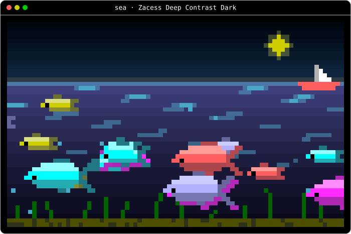

The sea, painted in solid pixels. The horizon sits three tenths of the way down. Above it the sky
brightens towards the horizon on a dark theme and pales towards it on a light one, with a glow
along its last row. A still sun hangs to the right. The water deepens and darkens as it goes down,
with highlights drifting across it that fade with depth. The surface line always catches some
light. A sandy bed with a fixed scatter of grains lies along the bottom.

Fish in three sizes, each with a forked tail, a dorsal fin, an eye and a lit back over a shaded
belly, swim both ways in five colours; the smaller fish are drawn behind the larger ones, as if
further off. Bubbles rise from the fish and from the bed, seaweed sways on the sand and a boat
with a hull, a sail and a mast drifts slowly along the surface, its hull dipping a pixel into the
water. It comes back round from the other edge. Now and then a whale crosses the deep water near
the bed, its first appearance between 8 and 20 seconds in and then 20 to 50 seconds after the last
one has gone.

- Colours: the sky, the glow, the water, the highlights, the sand and the seaweed are tints of the
  background below the non-text floor, towards the info colour, the warning colour, blue, yellow
  and green; on a dark theme the highlights lean towards bright cyan. The fish are in yellow,
  magenta, bright cyan, red and bright blue, each body shaded towards the light above and the deep
  water below but held at the non-text floor or above, with an eye in the background colour. The
  boat's hull is red, its sail the text colour and its mast the muted colour. The whale is the
  muted colour mixed into the deep water, kept apart from it. With colour off the fish and the
  boat keep their outline.
- Light themes: the sky is a day sky that pales towards the horizon and the sun is a pale disc in
  the background colour inside a warm halo, rather than a yellow sun with a soft edge. The
  highlights on the water are lighter tints rather than cyan ones.
- Small screens: the sun needs 20 columns and 13 rows. A screen under 6 rows has no sandy bed and
  one with too little water has no fish or seaweed. The whale needs 30 columns and at least 9
  pixel rows of open water.
- Reduced motion: the fish, the bubbles, the seaweed, the boat and the whale move at half speed,
  fish and the bed release bubbles less often and the highlights on the water are fewer and drift
  more slowly.
- Tests: the fish sprites have a forked tail, a fin and an eye, face the way they swim and come in
  three lengths; every sprite is rectangular; the sky, water and sand ramps stay distinct and in
  order in every theme, the imagery below the ceiling and the fish, hull and sail at the floor
  (the sun too on a dark theme); every theme paints a sky, a horizon, water that darkens
  downwards and sand along the bottom in 20 to 120 colours; text over the sea keeps the floor in
  pass and fail stills; the 256 colour fallback stays close and keeps the bands apart; every size
  from one cell to 400 by 120 and back; the flash limits at every motion setting in every theme;
  reduced motion changes under two thirds as many cells; the same seed paints the same pixels; a
  whale crosses an 80 by 24 sea within a minute and never a 20 by 8 one; fish stay in the water
  and the boat rides the surface; the shared pixel checks.

## rain

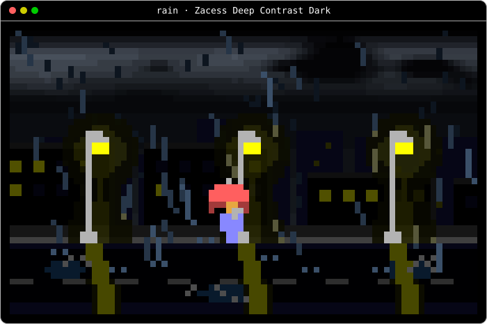

A wet street in the evening, painted in solid pixels. Low cloud lit from above drifts across the
top quarter of the sky, over a far skyline softened by the rain with a few windows still lit. A row
of nearer buildings with a lit roof line and side stands behind the pavement, their windows a grid
of small squares, some lit and some dark. Below the kerb runs a wet road with soft bands of sheen,
a dashed line down the middle and puddles. Street lamps on curved arms stand along the pavement,
about a third of the width apart, each throwing a soft round glow and a cone of light down onto the
pavement and a long reflection into the road that sways slowly as a whole.

Rain falls in sheets at three depths, all leaning a little with the wind: short, faint streaks far
off that land behind the near buildings, longer ones in the middle distance and long, bright ones
close by. Drops that pass through a lamp's light are lit. Middle and near drops make a small
splash where they land on the road and a ring that widens over 1.4 seconds where they land in a
puddle. Someone under a red umbrella with a shaded underside and a scalloped hem walks slowly
along the pavement, legs swapping about once a second. The walker comes back round from the far
edge.

Unless motion is reduced a bolt of lightning hangs from the cloud base behind the skyline for 0.12
seconds (`FLASH_LENGTH`): one jagged line with a short fork a third of the way down. It never
lights the sky: only its own line changes. The first comes 5 to 14 seconds in and the next 5 to 15
seconds after the last has gone. A strike also waits for five seconds since the last
(`MIN_LIGHTNING_GAP`) whatever else happens, so a resize, which clears a bolt on screen, never
brings the next one early. The storm the watch mode shows while a build fails is a scene of its
own, below.

- Colours: the sky, the clouds, the buildings, the windows, the pavement, the road, the puddles,
  the ripples, the lamps' glow and reflections and the rain itself are tints of the background
  below the non-text floor; the rain is a tint of the info colour mixed with the text colour. The
  lamps are bright yellow at the theme's floor, their posts the muted colour, the umbrella red and
  the walker's coat blue, all held at the non-text floor or above. The bolt is bright yellow.
  With colour off the lamp posts, the walker and the bolt keep their outline; the rain is imagery
  and drops away.
- Light themes: the same street on an overcast afternoon. The lamps are off, their heads the grey
  of the posts, with no glow, no lit rain and no reflections in the road. The lit windows hold the
  pale sky, fewer of them are lit and the sky is a pale grey under darker cloud.
- Small screens: the walker needs 14 rows and the puddles 11. A screen under 7 columns or 6 rows
  gets no bolt.
- Reduced motion: no lightning at all. The rain, the splashes and ripples, the cloud, the walker
  and the reflections move at half speed.
- Tests: the street and the rain stay distinct in every theme, the imagery below the ceiling and
  the posts, umbrella, coat and bolt at or above it, with the lamps at the floor on a dark theme;
  rain at three depths, a lamp, its reflection, the umbrella, a puddle and a splash all appear on
  an 80 by 24 street; no bolt ever appears under reduced motion over five simulated minutes; at
  least ten bolts come in five minutes, never less than five seconds apart, also with a new size on
  every frame; a bolt is one short line in the upper part that never lights the sky; a 6 by 4
  screen never gets one; the shared pixel checks.

### The storm

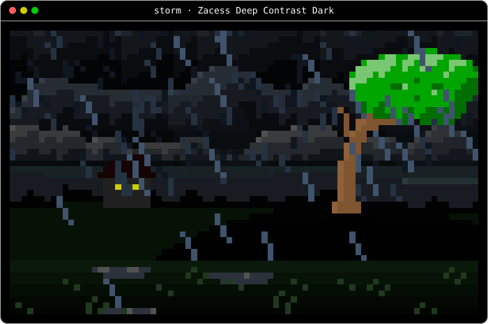

The watch mode shows a storm while a build fails. It is painted in solid pixels: a wide stretch of
country under three banks of cloud, the furthest highest and slowest and the nearest lowest and
quickest, each a row of rounded billows lit on the crown and the upwind side over a heavy dark
base. The top bank also covers the sky above it like an overcast. Curtains of rain hang slanting
below the cloud and a pale break of light lies along the horizon. Rain slants in the wind at three
depths. Far rain is short and slow and vanishes into the far hills. Middle rain falls into a field
with a hedgerow along its brow and a cottage with a pitched roof, a chimney and two lit windows.
Near rain falls in long fast streaks to the foreground. On a near hill a tree in full leaf, its
tapering trunk lit along one side, bends in the gusts (one gust every 4.5 seconds,
`GUST_PERIOD`) as its rounded crown of leaf clumps streams downwind. Tufts of grass lean with the
same wind and near drops that land in the puddles in the foreground send out small ripples that
spread over 0.9 seconds.

A bolt of lightning forks down from the cloud in the open sky left of the tree every 5 to 9
seconds, never closer than five seconds to the last (`MIN_LIGHTNING_GAP`). It stays on screen for
0.12 seconds (`FLASH_LENGTH`) as a thin line with one fork and a soft glow in the cloud where it
leaves it, never a large area. The first bolt waits five seconds from the moment the storm
appears, so the change to a storm never opens with a flash. A resize never brings the next one
early. Since 0.3.0 it is a scene of its own, `storm`, so it runs on its own and can go in the fail
list.

- Colours: the sky, the cloud, the curtains, the break of light, the hills, the hedgerow, the
  field, the grass, the puddles, the rain, the cottage walls and roof and the glow are tints of
  the theme's background held below the non-text floor, from a grey of the muted and info colours,
  an earth of green and the muted colour and a red roof. The tree is solid: its leaves in
  three shades of green and its bark a deep warm brown from the warning colour and red. The bolt is
  the bright yellow, so with colour off the tree and the bolt keep their outline.
- Light themes: a daytime storm. The sky is pale and the cloud darker than it, heaviest at its
  base, the break along the horizon is bright, the land grows greener nearer the eye and the
  cottage windows are a tint of yellow rather than the solid yellow of the night.
- Small screens: the tree needs 24 columns by 8 rows, the cottage 60 by 16 and a bolt 12 by 6;
  under 6 rows only the top bank of cloud is drawn.
- Reduced motion: no lightning at all, a third fewer drops falling at half speed, a gust every 9
  seconds and ripples spreading at half pace.
- Tests: over five simulated minutes at the standard, lively and calm levels there are at least
  20 bolts, the first after five seconds and every gap at least five seconds; no bolt in two
  minutes under reduced motion; the gaps hold with a new size every 13 frames; a bolt covers under
  a twentieth of the screen and is drawn, the tree stands at 80 by 24 with its bark and leaves
  drawn and a quarter gust is over a third of a second; the layers stay apart in every theme, the
  imagery below the ceiling and the tree at the solid floor; the shared checks and the shared pixel
  checks.

## snow

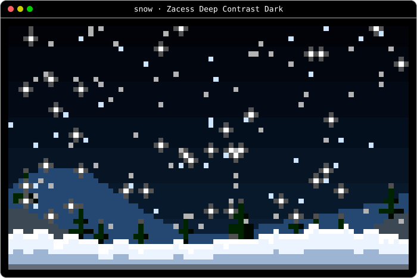

Snow painted in solid pixels: a winter sky that shades from its top to its lowest rows over two
rolling lines of hills, the nearer one with pines. Each pine is a narrow triangle in tiers, shaded
on its right, with snow on the left end of every tier and on its tip. Flakes at three depths drift
down with a slow sideways sway and settle where they land: a near flake is a bright point with a
soft cross of glow round it and falls fastest, a middle one a bright point and a far one a faint
point that falls slowest. Snow already lies along the bottom in low drifts when the scene opens.
About three flakes raise a column's bank by one row (`FLAKE_DEPTH`) and a column that stands more
than a row above its neighbour sheds into it, so the bank stays rounded. The bank has a bright
crust along its surface with a few fixed glints, then the body of the snow and blue shadow
gathering lower down. It never rises above a third of the screen and the snow already lying stays
where it is through a resize.

- Colours: on a dark theme it is a winter night. The sky, the hills, the pines and the glow round
  a near flake are tints of the background below the non-text floor, towards the info colour, the
  text colour and green. The flakes and the bank are white warmed a little towards the text
  colour, the middle flakes and the body of the bank held at the non-text floor, the far flakes in
  the muted colour and the bank's shadow in a cooler blue held above the imagery ceiling, so with
  colour off the flakes and the bank keep their outline.
- Light themes: a snowy winter day. The sky is a pale cool blue, deeper overhead, the flakes are
  pure white with a soft cool edge and the bank is white shaded blue underneath. The snow is
  imagery here, lighter than every part of the sky. The pines are a dark green held at the
  non-text floor, so with colour off the pines carry the outline.
- Small screens: the pines need 8 rows.
- Reduced motion: flakes fall and sway at half speed.
- Tests: the sky's top and bottom, the far and near hills, the sky and the pines stay apart in
  every theme with the backdrop below the ceiling; on dark themes the flakes and the bank keep the
  floor and stand apart from the sky, the hills and the pines, while by day the snow is imagery
  apart from the sky and the hills and the pines keep the floor; flakes of all three depths are
  drawn and settle into a bank on the bottom row; the bank never passes a third of the screen
  over ten simulated minutes; the shared pixel checks.

## starfield

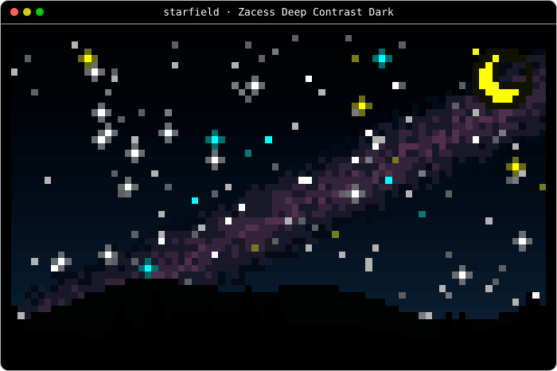

A night sky painted in solid pixels: a sky that lightens from its top towards the horizon and a
faint diagonal band of the galaxy made of fixed speckle, so it never moves or flickers. Stars
brighten and fade slowly, each on its own cycle of 2.5 to 6 seconds. A bright star grows from a
dim point to a full point and then to a small cross at its brightest, so its brightness is a
change of shape as well as of colour; a few are tinted yellow or cyan. A faint star moves between
a dimmed and a full point. A crescent moon with a faint halo hangs top right when the screen is
at least 24 by 8. On a screen at least 6 rows tall the sky meets two low lines of hills along the
bottom, the far one paler and the near one with small pines along its crest. Every 8 to 20
seconds (the first after 6 to 16) a shooting star crosses the upper sky at about 15 cells a
second, its trail fading back into the sky, then is gone within two and a half seconds. A resize
that cuts one short makes the next wait its full time.

- Colours: on a dark theme the sky is a tint of the background towards the info colour and the
  galaxy's band a tint towards magenta mixed with the text colour, both below the non-text floor.
  The far hills are a faint tint towards the info colour and green and the near hills are darker
  than the sky. The bright stars are in the text colour, bright yellow and bright cyan, the faint
  stars in the muted colour, the moon in bright yellow and the shooting star's head in the
  strongest text colour. A dimmed star is held above the imagery ceiling, so with colour off
  every star keeps its outline.
- Light themes: the same sky at dawn, deep blue overhead through a soft lilac to gold at the
  horizon, with no galaxy. A pale white morning moon hangs top right and only the bright stars
  high in the deepest blue are still out, soft and white. The stars, the moon and the shooting
  star are pale imagery here and the near hills, a soft blue green, are solid enough to keep the
  outline.
- Small screens: the moon needs 24 columns and 8 rows, the hills 6 rows and a shooting star 10
  columns.
- Reduced motion: cycles take 5 to 10 seconds, shooting stars come every 20 to 40 seconds (the
  first after 15 to 30) and move at half speed.
- Tests: the sky's top and bottom, the two hill lines and the far hills and sky stay apart in
  every theme, with the sky, the galaxy, the halo and the far hills below the ceiling; on dark
  themes the stars, the moon and the shooting star keep the floor, stand apart from the sky and
  the galaxy and keep an outline at their dimmest, while at dawn they are imagery and the near
  hills keep the outline; no star has a cycle shorter than `MIN_TWINKLE_PERIOD` and the moon is
  drawn top right at 60 by 20 but not at 20 by 8; a bright star grows into a cross and shrinks
  back; a shooting star crosses the sky and the calm one is slower; the shared pixel checks.

## code-rain

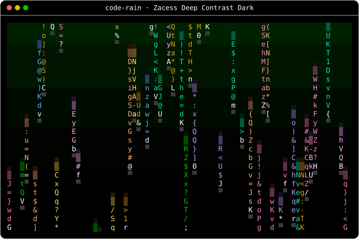

Every column of the screen is a stream of characters (letters, digits and symbols, all ASCII) that
falls from the top at its own speed, with a bright head and a tail that fades away. The characters
are text, drawn over a softly shaded backdrop painted in pixels that fades from a tint of the
comment colour at the top to the background at the bottom. Each column's head throws a faint glow
on the cell below it and the last two characters of its tail have faded into two steps of pixels
in the column's colour. About half the columns are already falling when the scene opens. Each
character in a falling column is swapped for a new one about once a second on average. A column
that has fallen off the bottom waits a while before falling again; the wait and the speed both
scale with the height of the screen, so a short terminal stays full and a tall one is not a blur.

- Colours: each column takes one of the theme's nine syntax colours and the head is the strongest
  text colour. The backdrop is the strongest tint every text colour still keeps its floor against.
  The glow and the fading tail are tints of the background below the non-text floor, so with
  colour off the characters are what remains. The same look serves light and dark themes.
- Small screens: a column falls at 4 to 10 rows a second scaled by the height over 24 rows, from
  half to one and a half times. It waits at most a fifth of the height in seconds, between 1.5
  and 8, before falling again.
- Reduced motion: columns fall at 1.5 to 3 rows a second (`CALM_MAX_SPEED`) and a column's
  characters are never swapped. The trail still scrolls, so a cell shows a new character each time
  the column moves down a row: at most three times a second.
- Tests: the backdrop stays below the ceiling and keeps every syntax colour and the head on their
  floor in every theme, with the tail and the glow below the ceiling; columns fall in syntax
  colours with a bright head, on the backdrop rather than on a hole cut out of it; under reduced
  motion a falling column's characters stay the same and no cell changes more than three times in
  any second at 20 by 8, 80 by 24 and 120 by 40; the shared pixel checks.

## fireflies

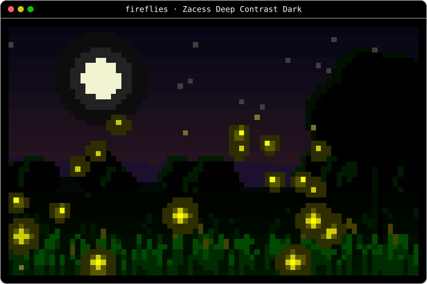

A meadow at dusk painted in solid pixels. A sky that deepens overhead and warms towards the hills
holds a few stars and a moon with a soft halo, on the side away from one great tree that stands in
the meadow. Two bands of hills, the far one paler and higher, meet a line of rounded tree crowns
along the far edge of the meadow, with gaps of open sky between the clumps; every crown is lit on
the side towards the moon. Long grass sways gently at its tips in the foreground, deeper green
towards the front, the nearest blades catching the light and a few carrying seed heads.

Fireflies drift with a gentle random walk in the lower two thirds of the screen, bouncing off the
edges and staying just above the bottom. Each light pulses on its own cycle of 2.5 to 5 seconds:
it is hidden at its faintest, then a dim point, then a point inside a soft glow and at its peak a
bright point with a smaller, stronger glow inside the soft one, so its brightness is a change of
shape as well as of colour. A light over the meadow is near, so it is larger and takes a cross of
light round its point; one over the trees is far and small.

- Colours: on a dark theme the sky, the stars, the halo, the hills, the trees, the grass and every
  glow are tints of the background below the non-text floor, towards blue, magenta, the warning
  colour, green, yellow and the text colour. The moon is the text colour warmed towards yellow,
  the lights are yellow, bright yellow at their peak and a dimmed yellow held above the imagery
  ceiling, so with colour off the moon and the lights keep their outline.
- Light themes: a bright summer afternoon in place of the night. A pale gold sun with a soft halo
  hangs in a pale sky with slow clouds, the trees are a little darker than the grass, wild flowers
  in magenta, blue and gold dot the front of the meadow and up to four butterflies drift about,
  their wings opening and closing once every 1.3 seconds (`FLUTTER_PERIOD`). The fireflies' paths
  are taken by motes of pollen, a gold point that takes a faint cross of glow at the top of its
  cycle. The sun and the pollen are imagery here; the flowers and the butterflies keep their
  outline with colour off.
- Small screens: the moon or the sun needs 6 rows, the great tree 8 rows and the butterflies and
  clouds 10 rows.
- Reduced motion: each light's cycle is drawn from 5 to 9 seconds and runs at half pace, so it
  takes at least 10 seconds; the lights wander at under half the speed (`top_speed` 1.4 pixels a
  second rather than 3), the grass sways at half speed and by day the clouds and butterflies move
  at half speed and the wings beat half as often.
- Tests: the sky's top and bottom, the hills, the trees and their lit edges, the blades and the
  grass and the halo and the sky stay apart in every theme, with all the backdrop and every glow
  below the ceiling and the flowers and wings above it; on dark themes the lights and the moon keep
  the floor and stand apart from the sky and a dimmed light keeps an outline, while by day the sun
  is a pale disc below the ceiling; no light has a cycle shorter than `MIN_PULSE_PERIOD` and over
  three seconds the dim, lit, bright and glowing lights and the moon all appear; by day in Deep
  Contrast Light there are butterflies, flowers and pollen; the flies stay inside a 20 by 8 screen
  under reduced motion at no more than the calm top speed; the shared pixel checks.

## aurora

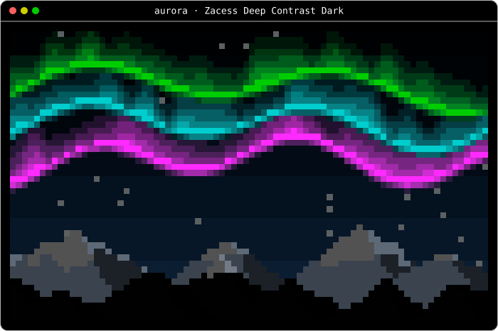

Aurora painted in solid pixels: two or three curtains of colour across the upper half of a starry
sky, centred 17, 30 and 42 hundredths of the way down. Each is a slow wave made of two sine waves
whose phase drifts at its own speed. Each curtain burns brightest along its lower edge and fades
upwards in soft rays of different heights, the way the folds of a real aurora hang. Below the edge
it fades out within a pixel and a half. Its thickness breathes gently, once every 21 seconds
(`BREATH_RATE`). A ridge of overlapping straight-flanked peaks runs along the bottom, each peak
split at its summit into a lit face and a shaded one, with snow on the high ground that lies deeper
the higher the peak.

- Colours: the sky, the faint parts of the curtains and their glow are tints of the background
  below the non-text floor. The curtains are green, cyan and magenta. On a dark theme their
  brightest edge reaches the theme's own colour, so with colour off the curtains keep their
  outline; the ridge is a tint of the background, its snow a tint of the text colour and the stars
  the muted colour held at the non-text floor.
- Light themes: the same sky at the blue hour, deep blue overhead and paler with a touch of magenta
  lower down. The curtains are pale light, each colour mixed with white and held below the non-text
  floor, over dark mountains drawn at the non-text floor or above with white snow on their crests,
  so with colour off the mountains keep their outline. Stars show only in the top third of the sky.
- Small screens: two curtains rather than three under 10 rows.
- Reduced motion: the waves drift and breathe at half speed, one breath every 42 seconds.
- Tests: the sky, ridge and snow stay apart in every theme with the sky and snow below the ceiling;
  on a dark theme the ridge is imagery, the stars clear the ceiling and the curtains keep the floor
  apart from the sky, while on a light theme the mountains clear the ceiling and the pale curtains
  stay below it and apart from the deep sky; every curtain starts faint as it fades in from the sky;
  at 80 by 24 the curtains light the top half and none of the bottom eight rows, the picture changes
  over time and the ridge stands along the bottom; the calm curtains move at exactly half the speed;
  the shared pixel checks.

## campfire

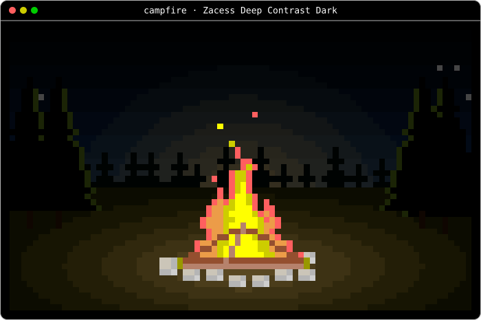

A campfire in a clearing, painted in solid pixels. A far treeline of narrow pines closes the
clearing and on a screen at least 24 columns by 8 rows taller pines stand near on each side,
one a side, two from 60 columns and three from 140, each lit on the side facing the fire. On the
ground a log lies across a bed of coals, hottest in the middle, with three more leant together
over the fire and lighter cut ends, inside a ring of stones lit on top and shaded underneath. The
flame rises from a base about a quarter of the screen wide (3 to 31 columns) to about two fifths
of its height (2 to 20 rows), split into three pointed tongues over a rounded body with the middle
one tallest, hottest at its core and outlined in red. A still glow warms the air and lights a wide
pool of ground round the fire; it never changes, so it can never flash. On a night sky at least 8
rows tall a few still stars sit high up, clear of the glow.

Each cell row of the flame takes a new lean and width every 0.6 seconds (`FLICKER_PERIOD`), the
rows on staggered timers so the fire never changes all at once. A row switches straight to its new
shape rather than blending, because a blend can cross a shade boundary several times on the way;
so no flame cell changes more than twice in any second. A resize keeps the rows the flame still
has. Up to 24 embers rise from the top of the flame, about two a second, drifting and cooling
through three colours over one and a half to three seconds.

- Colours: the sky, the trees, the ground and the glow are tints of the background below the
  non-text floor, towards the info colour, green and the warning colour. On a dark theme the core is
  bright yellow, the body of the flame yellow and its outline red. The embers cool from bright
  yellow through yellow to red. The logs are the red burnt down towards the dark, the stones a grey
  mixed with the muted colour and the coals red with the hottest in the warning colour, all held at
  the non-text floor or above, so with colour off the flame, the logs, the stones and the embers
  keep their outline.
- Light themes: a late afternoon instead of a night, the sky pale blue overhead and warm towards
  the trees, with no stars. The flame is a bright yellow and orange heart held as imagery inside its
  solid red outline and the embers cool from the warning colour to red.
- Small screens: the near pines need 24 columns and 8 rows, the stars 8 rows and the ring of stones
  12 columns with a row below the logs.
- Reduced motion: each row changes every 1.5 seconds (`CALM_FLICKER_PERIOD`), so a cell at most
  once a second. Embers come about 0.7 a second instead of two and rise and drift at half speed.
- Tests: the sky, ground, glow and warm air stay apart in every theme and below the ceiling with
  the trees and stars; the flame's outline keeps the floor in every theme and its core and body do
  too on a dark theme, while on a light theme the heart stays below the ceiling and apart from the
  sky and the outline; the logs, stones and coals clear the ceiling apart from the glow; at 60 by
  20 the logs, their ends, the core and the outline are drawn and embers rise above the flame; with
  the flame painted alone over 30 seconds at 20 by 8, 80 by 24 and 120 by 40, no flame cell changes
  more than twice in a second (once under reduced motion); each row takes about one shape a period;
  a resize keeps the rows; the shared pixel checks.

## waves

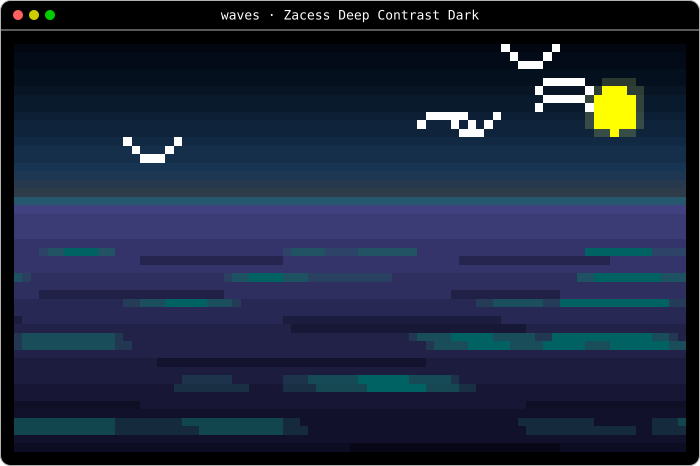

A calm sea to the horizon painted in solid pixels. The horizon sits two fifths of the way down
with a still sun with a soft edge top right (on a screen at least 16 wide with at least three rows
of sky). The sky warms to a glow over its last few rows. Below the horizon, lines of swell crowd
together towards the horizon and roll slowly in, each broken into streaks that lengthen towards
the viewer, with troughs in shade and a path of light under the sun. The horizon line always
catches the light. One to six gulls, by the size of the screen, cross the sky both ways, their
wings moving through four positions over a 1.6 second beat (`FLAP_PERIOD`). The sun is painted
last, so a gull passes behind it.

- Colours: the sky, the glow and the sea with its crests and troughs are tints of the background
  below the non-text floor, towards the info colour, the warning colour, blue and on a dark theme
  bright cyan. The far sea is hazier and the near sea deeper. The gulls are in the text colour with
  a body in the strongest text colour, so with colour off the gulls keep their outline. On a dark
  theme the sky brightens towards the horizon and the sun is bright yellow with a faint ring.
- Light themes: the sky is deepest overhead and pales towards the horizon, the crests are the sea
  mixed back towards the paper and the sun is a pale disc in the background colour inside a warm
  halo, never a dark disc.
- Small screens: the sun needs 16 columns and three rows of sky; a screen too small for it, such as
  12 by 5, still shows the sea and its horizon line.
- Reduced motion: the swell, its drift and the gulls at half speed and the wing beats at half pace,
  one beat every 3.2 seconds at the most.
- Tests: the bands stay distinct and in order in every theme, the near sea darker than the far,
  every part of the sky and sea below the ceiling; the gulls and, on a dark theme, the sun keep the
  floor apart from the sea and the sky; on a light theme the pale sun and its halo stay apart
  from the sky; at 60 by 20 the sea fills below the horizon with the sun and a gull drawn in the sky
  and neither the sky's top colour nor a gull below it, a wing position lasting at least a third of
  a second; the sun and the horizon line are drawn at 20 by 8 and only the horizon line at 12 by 5;
  the shared pixel checks.

## zacess

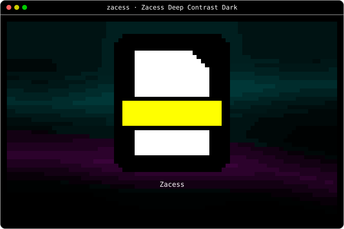

The Zacess mark painted in solid pixels: a page with a folded top right corner and a band across
its middle that reaches past the page on both sides, on a tile with rounded corners. At pixel
resolution the fold is a true diagonal. The mark is scaled to the screen, its page about half the
height, so it is the clear subject at every size; it shrinks until it fits, down to a page 8 pixels
tall (`SMALLEST_PAGE`); a screen too small even for that shows a still `Z`. It floats slowly
round a small loop about the middle of the screen and never reaches an edge. A pixel row of
background above and below the band, across the whole tile, keeps the band apart from the page and
the tile, so it stays visible where its colour is close to theirs and with colour off. On a screen
at least 14 rows tall with room for it the word `Zacess` sits beneath the mark as text.

Behind the mark a soft wash of the accent colour is strongest at the top and fades down the screen.
Two broad ribbons, one cyan and one magenta, flow gently across it in opposite directions and a
quiet halo follows the tile.

- Colours: the wash, the ribbons and the halo come from a small table of tints held below the
  non-text floor and kept weak enough for the word to keep its floor against them. On a dark theme
  the tile is the background and the page the text colour, with the band in bright yellow. The
  halo lightens the backdrop.
- Light themes: the tile is the text colour and the page the background, which keeps the mark's own
  light page on a dark tile; the band is the theme's yellow and the halo fades the backdrop back
  towards the paper.
- Small screens: the word needs 14 rows and 8 columns; a screen too small for the smallest page
  shows a still `Z`.
- Reduced motion: the mark floats, the ribbons flow and the halo follows at half speed.
- Tests: the mark fits a phone-sized terminal and grows with the screen, about half the height at
  120 by 40 with the word, without it at 20 by 8 and with nothing at 8 by 6; the backdrop table
  stays below the ceiling, keeps the word on its floor and keeps its ends apart; the band keeps
  the floor; the page, band, word and fold are drawn in both appearances; the band never touches a
  pixel of the text colour in any theme at four sizes; without colour the band row is wider than the
  page with blank rows above and below it; the mark moves, stays inside the screen and keeps near
  the middle at three sizes; the shared pixel checks.

## forest-stream

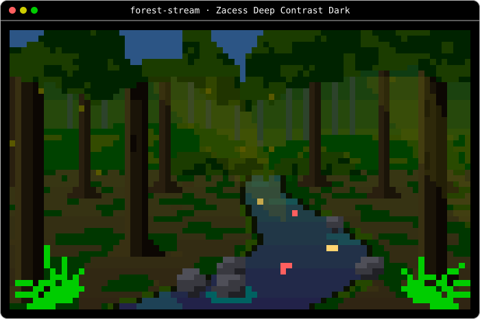

A stream winding through a forest towards the viewer, drawn in solid pixels. Trunks stand at
three depths in the haze between the trees: the far ones one pixel wide and faint, the middle ones
two wide and the near ones wide with bark, each shaded on its right side because the light comes
from the left. The nearest trunks keep clear of the middle of the screen so the stream stays in
view. A canopy runs along the top with gaps of sky. Shafts of light slant down through the trees
and drift one shaft's width every 40 seconds (`LIGHT_PERIOD`).

The forest floor, patched with moss, starts a little over halfway down. The stream starts narrow
at the far end and widens and winds as it comes nearer, its water deepening in colour towards the
viewer and its ripples flowing down it. Stones lit from the upper left sit on its banks and, one in
three, out in the water. Leaves ride the current, moving faster as they come nearer, then start
again at the far end. Three ferns arch up from the near banks and motes of dust drift slowly
through the light, bobbing as they go.

- Colours: the haze, the trunks, the canopy, the sky, the light, the floor, the moss and the water
  are tints of the background below the non-text floor, towards green, the muted colour, yellow,
  the info colour, bright yellow, cyan and blue. The stones are the muted colour held at the
  non-text floor, the ferns green and the leaves yellow, red and bright green, so with colour off
  the stones, the ferns and the leaves keep their outline.
- Light themes: the sky and the shafts of light are fainter tints, the ripples a faint tint of the
  info colour rather than bright cyan and the stones are lit towards the background and shaded
  towards the text colour.
- Small screens: the ferns need 30 columns and 8 rows. The leaves scale with the width (one per 16
  columns, one to eight), the motes with the area and the stones with the width.
- Reduced motion: the water, the leaves, the light and the motes move at half speed.
- Tests: the haze, the trunks, the canopy, the light, the floor and the water stay apart in every
  theme; the stream is more than four times as wide near the viewer as at its far end and the
  leaves ride it downstream; the shared scene checks and the same seed painting the same frame;
  the shared pixel checks and the palette held to the imagery and shape rules.

## desert-night

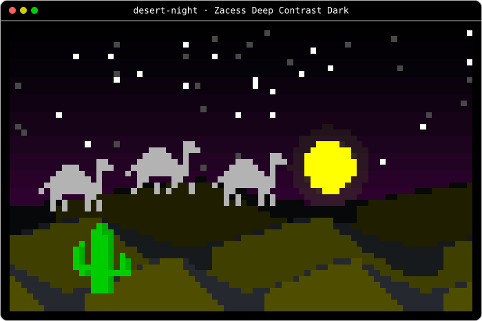

Desert dunes under a night sky, drawn in solid pixels. The sky deepens from the horizon to the
top. Stars fill its upper half and each one switches between a bright and a dim shade on its own
phase of a seven second cycle (`STAR_PERIOD`), so it changes twice a cycle. A moon with a soft halo
has just cleared the dunes when the scene opens and climbs on a slow arc for the rest of two and a
half minutes (`MOON_SECONDS`), then stays.

Three ranges of dunes lie one in front of the other, each dune rising gently to a sharp crest and
dropping more steeply beyond it, with its steep slip face in a wedge of shade under the crest. A
caravan of three camels walks the far ridge nose to tail, their legs changing step every 0.6
seconds, leaving one side and coming back in at the other. A saguaro cactus with two raised arms
stands in the foreground, shaded on its right side. Now and then a short shooting star crosses
the upper sky, the first after 25 to 40 seconds and then every 25 to 45 seconds, gone after 1.6
seconds.

- Colours: the sky, the halo, the dim stars and the dunes are tints of the background below the
  non-text floor, the sky from blue to magenta and the dunes from yellow with their shade leaning
  towards blue. The moon is bright yellow, the bright stars and the shooting star the text colour,
  the camels the muted colour and the cactus green with a shade held at the non-text floor, so with
  colour off the moon, the stars, the camels and the cactus keep their outline.
- Light themes: the same desert at sunrise. The sky is a dusty blue warming towards the horizon,
  the moon is a pale sun in a soft glow, both tints below the non-text floor, the dunes are golden
  with warmer, stronger shade and there are no stars or shooting stars. The camels are a warm dark
  silhouette.
- Small screens: the moon needs 16 columns and 5 rows, the camels 30 columns and 8 rows and the
  cactus 40 columns and 12 rows. The number of stars scales with the area.
- Reduced motion: stars change half as often, the moon and the camels move at half speed and there
  are no shooting stars.
- Tests: the sky, the halo and the lit and shaded sides of every dune stay apart in every theme, as
  do the far dunes and the sky; the sprites keep their widths; the moon rises at least ten
  pixels over 200 seconds and then holds; at every motion setting no star changes within half a
  cycle of its last change; the shared scene checks and the same seed painting the same frame;
  the shared pixel checks and the palette held to the imagery and shape rules.

## rooftops

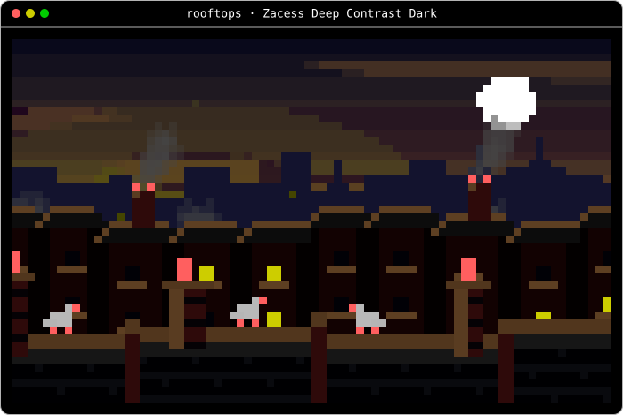

Rooftops at dusk seen from a high window, drawn in solid pixels. The sky fades from deep blue
through a band of rose to a warm glow where the sun has just gone down, with long thin clouds lit
from below drifting slowly across it and a crescent moon high on the right. A far skyline of
towers, now and then with a spire, carries a few lit windows.

Across the middle a terrace of houses has pitched roofs with a lit rim along each ridge, some with a
small chimney and two pots. Each has rows of windows, about a third of them lit at the start.
Windows light up or go dark one at a time, never more often than every 2.4 seconds (`WINDOW_GAP`).
Close by, big slate roofs fill the bottom of the view, with courses of slates, a lit ridge, brick
party walls between them, dormer windows and chimney stacks whose left face catches the last of the
sun. Each stack carries one or more pots and some a television aerial. Smoke leaves every pot every
1.1 seconds, rising straight at first, then leaning with the breeze as it spreads and fades over
seven seconds. Pigeons sit on the near ridges, a little apart. Every 9 to 17 seconds one flies
across to another ridge along a low arc, its wings beating once every 0.8 seconds (`WING_PERIOD`).

- Colours: the sky, the glow, the clouds, the skyline and its windows, the walls, the roofs, the
  bricks, the dark windows and the smoke are tints of the background below the non-text floor. The
  lit windows are yellow, the chimney pots red, the aerials the muted colour, the moon the
  strongest text colour and the pigeons grey with a darker wing, so with colour off they keep their
  outline.
- Light themes: the same street in late afternoon. The sky is pale, warming towards the horizon,
  a low sun stands where the glow is and there is no moon. The far towers are pale with distance
  and the nearest slates the strongest tints. A lit window is the sun on its glass, a gold tint,
  so in light themes the sun and the lit windows are imagery below the non-text floor and drop
  away with colour off.
- Small screens: the street is laid out in proportion to the height. Dormers and aerials need 28
  rows, the moon is a full disc rather than a crescent under 25 rows and windows grow from two
  pixels to three from 41 rows. A terrace house needs to be 10 columns wide for a chimney. The
  number of pigeons scales with the width, one per 24 columns, one to six.
- Reduced motion: windows change half as often and the smoke, the clouds and the pigeons move at
  half speed, the wings beating half as often.
- Tests: the sky, the skyline, the terrace, the roofs and their rims, the slates, the windows and
  the chimneys stay apart in every theme and the pigeon sprites keep their widths; over 90 seconds
  at every motion setting windows change one at a time, at least five times and never closer than
  `WINDOW_GAP` at that pace; every perched pigeon sits on a ridge; every chimney pot has smoke
  over it; the shared scene checks and the same seed painting the same frame; the shared pixel
  checks and the palette held to the imagery and shape rules.

## lily-pads

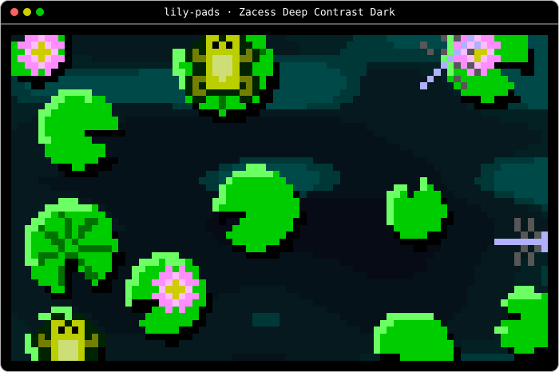

A pond seen from above, drawn in solid pixels. The water is deepest in the middle and shallows
towards the edges, with long soft streaks of reflected sky drifting slowly across it, each
brightest streak fringed by a softer step. Round lily pads keep a little open water between them,
each with a notch cut to the middle, a lit rim on one side and a faint shadow on the water; the
widest pads also show fine veins. Water lilies with pointed outer petals, paler inner ones and a
gold heart open on every third pad that has no frog.

Frogs seen from above sit on the biggest pads, never two to a pad. Every 6 to 11 seconds
(`HOP_GAP` and up to five more) one hops to the nearest free pad without a flower that is big
enough for it, along a low arc lasting 0.9 seconds, its shadow sliding across the water below it.
A ring of ripples spreads where it leaves and another where it lands, fading within 2.4 seconds.
Dragonflies, each a thin body with two pairs of see-through wings, dart from spot to spot and
hover for 1.5 to 4 seconds between darts.

- Colours: the water, its reflections, the shadows, the ripples and the wings are tints of the
  background below the non-text floor, towards blue, cyan and bright cyan. The pads are green with
  a bright green rim and darker veins, the lilies magenta with yellow hearts, the frogs a strong
  yellow green with a dark rim round them and the dragonflies bright blue, so with colour off the
  pads, the lilies, the frogs and the dragonflies keep their outline.
- Light themes: the frogs are the theme's yellow with a pale back and a pale rim, the lilies the
  plain magenta with pale inner petals, the shadows a stronger tint and the reflections, the
  ripples and the wings faint tints of the info colour.
- Small screens: pad size follows the height and the number of pads the area, from three to 40 as
  room allows; there is one frog for every four pads, one to five. A pond with no pad of radius 5
  (`FROG_PAD`) gets small frogs and lilies shrink on small pads. One dragonfly per 40 columns, one
  to four.
- Reduced motion: frogs hop half as often, the ripples, the hops and the light on the water move
  at half speed and the dragonflies dart at under a third of their standard speed.
- Tests: the water, the light, the ripples, the shadows and the pads with their rims and veins stay
  apart in every theme, frogs and lilies stand clear of their pads and the sprites keep their
  widths; at 120 by 34 every frog sits on a pad big enough for it with no flower; over two minutes
  at every motion setting frogs never share a pad, hop at least three times and never closer than
  `HOP_GAP` at that pace; the shared scene checks and the same seed painting the same frame; the
  shared pixel checks and the palette held to the imagery and shape rules.

# Pass scenes

Calm scenes made for a passing build. Each has captions of its own for the watch mode.

## koi-pond

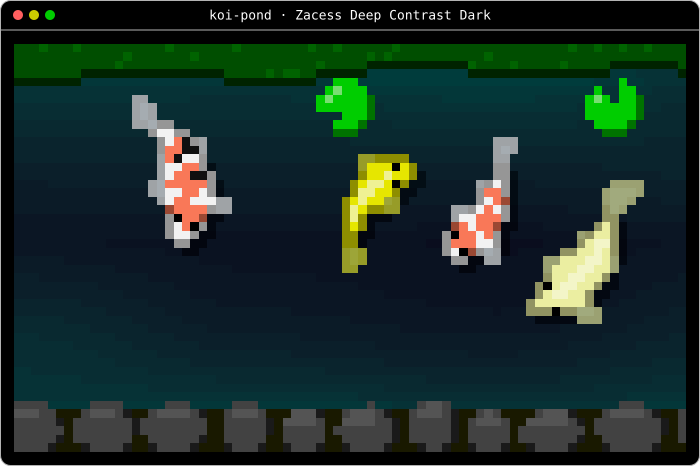

A garden pond seen from above, painted in solid pixels. The water is shallow at the banks and
deepens gently towards the middle, its depth steps meeting along soft curves. Five to seven koi at
120 by 34, fewer on a smaller screen, swim slow curving paths seen from above. Each is drawn from
its spine rather than a sprite, so it can face any way: a blunt rounded head with two eyes, a body
widest about a third of the way back that tapers to a narrow stalk, a fanned tail cut back in the
middle, pectoral fins just behind the head and small pelvic fins further back. The body bends into
each turn and a slow swimming wave runs down it to the tail, one sweep there and back every 2.6
seconds (`TAIL_BEAT`). The silhouette is worked out on a small grid first, so pinholes are filled
and stray pixels dropped before it is painted. Every body has a one pixel rim along its edge against
the water. A koi never turns faster than 0.65 radians a second. It steers back from the banks, round
the pads and away from the other koi, so two fish never merge into one shape. A soft shadow lies a
pixel down and to the right of each body. Lily pads rest along the banks, some tucked partly under
the grass, round with a notch, a shaded rim and a lit edge, some of the larger ones with a small
flower, drifting very slowly. Every few seconds a faint ring spreads where something touched the
surface, with a fainter inner ring, widening to seven pixels and fading over 3.2 seconds
(`RIPPLE_LIFE`); no more than three show at once. A grassy bank runs along the top and a rim of
rounded stones, lit from the top left, along the bottom.

- Colours: five classic varieties with their markings laid out along the body, so they bend with it:
  kohaku (white with red), sanke (white with red and small black spots), showa (black with red and
  white), yamabuki (gold) and ogon (pale metallic gold); the gold varieties catch the light along
  the back. The red, gold and black come from the theme's red, yellow and grey. The fins are the
  body colour mixed with the water. The pads are in green with flowers in bright magenta and bright
  yellow centres. The water, the shadows, the bank, the soil and the stones are tints of the
  background below the non-text floor.
- Light themes: deeper water is darker here too, moving away from the background rather than sinking
  into it. A white koi is the paper colour outlined by a dark rim, gold is lifted towards the paper
  and the flowers on the pads are a pale magenta. On a dark theme a black koi is a dark body
  outlined by a lighter rim, so every koi keeps its outline with colour off.
- Small screens: koi are a little larger than proportional on a small screen, so they keep their
  head, fins and tail; the eyes show only on a koi 11 pixels long and the pelvic fins on one 13
  long; below 8 rows there are no banks, below 10 columns no koi and ripples need 16 columns and 12
  pixel rows of water. Large pads need 30 columns.
- Reduced motion: koi swim and turn at half speed, their tails sweep half as far and half as often,
  ripples come every 8 to 14 seconds instead of 4 to 8 and spread half as fast.
- Tests: the tail beat and ripple never run faster than their constants and take at least twice as
  long when calm; koi stay in the water over two simulated minutes at the lively level and the pads,
  koi, stones and bank are drawn; there are five to seven koi at 120 by 34; their spines never come
  within two pixels of each other over two minutes; a koi has a body, fins, a tail and two eyes with
  no pinholes or stray pixels; a koi covers about the same number of pixels facing any way; each
  variety carries its own markings; the water, bank, stones and shadows stay below the ceiling and
  every rim and pad above it, apart from the water, in every theme; the 256 colour table keeps the
  water, bank and pads apart; the shared pixel checks pass.

## harbour

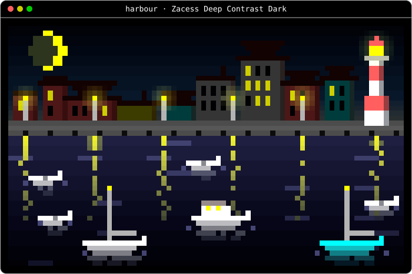

A small harbour town at night, painted in solid pixels. A row of houses of one to four storeys with
pitched or flat roofs, some windows lit and some dark, stands behind a stone quay with a light
coping and lamps along the promenade, each with a soft glow. The water darkens with depth and has a
few long swell lines drifting slowly. Each lamp throws a column of light two thirds of the way down
the water that fades as it goes, broken here and there with short glints either side near the top.
The column shimmers on a slow beat, one change every 0.8 seconds (`SHIMMER_PERIOD`). Moored sailing
boats, cabin boats and rowing boats sit at several depths, each with a raised bow and a dim, broken
reflection below it that changes on the same beat. A sailing boat has a furled sail along its boom
and a riding light at its masthead; the top of the mast leans to one side or the other over a four
second sway (`SWAY_PERIOD`) and the water laps either side of each hull in time with it. A cabin
boat has a wheelhouse with two lit portholes. A lighthouse striped in two colours, with a gallery
and a steady glowing lamp, stands at the end of the quay and throws its own reflection. A moon with
its dark side faintly showing and a few stars hang over the town. Now and then a ferry with a funnel
and a row of lit windows crosses the far water at 0.8 pixels a second, every 8 to 25 seconds.

- Colours: boats in the text colour, bright cyan or red, lamps and the moon in bright yellow, lit
  windows in yellow, posts and furled sails in the muted colour, the lighthouse in the text colour
  and red, the ferry and the wheelhouses in the text colour with a red funnel. The sky, the houses,
  the roofs, the quay and the water are tints of the background below the non-text floor.
- Light themes: the same harbour on a sunny afternoon. The sky is blue, deeper at the top, with
  three clouds drifting slowly over the town and no stars or moon. The windows are pale sunlit
  panes, the lamps stand unlit as small glass heads under a dark cap with no glow or reflection and
  the lighthouse is white and red with no glow. The boats are painted blue, red or green, the
  wheelhouses and the ferry are white.
- Small screens: the lighthouse needs 50 columns and six rows above the quay, the lamps four rows
  above it, the moon 40 columns and seven rows, the clouds six rows and the ferry 40 columns and
  eight rows below the quay. Water under 12 pixels deep gets rowing boats only.
- Reduced motion: masts stay upright and the water stops lapping. The shimmer changes half as often
  and the ferry, the swell and the clouds move at half speed.
- Tests: the shimmer and sway periods hold at every motion setting and the masts stay upright when
  calm; the quay's coping runs all the way across, the lamps and the lighthouse are drawn and a
  reflection reaches the water; at 20 by 8 the lighthouse is left out; the sky, houses, roofs, quay
  and water stay apart and below the ceiling in every theme, the hulls and stripes (and at night the
  lamps, windows, lighthouse and ferry) keep the floor apart from the water, while by day the lamps,
  panes, lighthouse, ferry and clouds stay imagery; the 256 colour table keeps the bands and the
  hulls apart; the shared pixel checks pass.

## lanterns

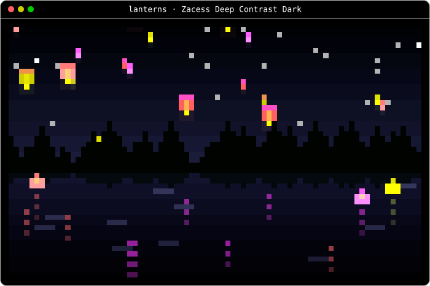

Paper lanterns rise slowly from a dark lake into a starry sky at three depths, painted in solid
pixels: far ones as a small glowing point two pixels tall, middle ones as a little lantern with a
flame in its base and near ones as a larger lantern, dim paper at the top and brightest near the
flame. Far lanterns rise slowest and near ones fastest, never more than 1.8 pixels a second. Each
casts a soft halo in the sky around it, larger the nearer it is, which never spills onto the water.
Each sways a column either way over seven seconds (`SWAY_PERIOD`). The middle and near lanterns
leave a broken streak of light on the water as far below the shore as they are above it, squeezed by
half, so the reflection slides down as the lantern climbs. A lantern starts behind a far line of
pointed pines and comes into view as it clears them; the pines' dark reflection lies along the shore
and a few long swell lines drift across the water. A few more lanterns float on the surface,
drifting slowly to the right with their light running down the water below them.

- Colours: lanterns in bright yellow, yellow, bright red, red and bright magenta with a dimmer paper
  shade and flames in bright yellow. The sky, the pines and the water are tints of the background
  below the non-text floor, as are the reflections.
- Light themes: the lanterns rise at dusk. The sky is violet blue at the top, paling to peach over
  the pines, with no stars. Each lantern is bright painted paper in amber, orange, red, rose or
  violet, its top a shade deeper, with a pale glowing heart, a pale flame and a soft warm halo.
- Small screens: near lanterns need 30 by 14.
- Reduced motion: lanterns rise, sway and drift at half speed and the swell lines drift at half
  speed.
- Tests: lanterns rise (the fastest under a row a second) and the sway period holds; the row of
  pines above the shore and a lantern's flame in the sky are drawn; no near lantern at 20 by 8; the
  sky, pines and water stay apart and below the ceiling in every theme; the paper keeps the floor at
  night and stays solid at dusk, apart from the sky and water, while the dusk flame, heart and halos
  stay imagery; the 256 colour table keeps the pines, water and lanterns apart; the shared pixel
  checks pass.

## balloons

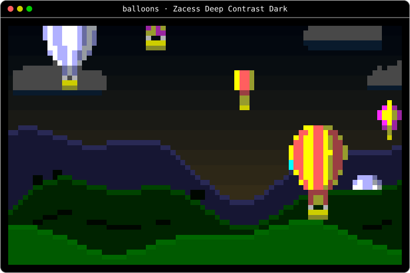

Hot air balloons in three sizes lift slowly from behind three ridges of rolling hills and drift on a
light wind, painted in solid pixels. Each envelope has a round crown that narrows to its mouth, is
striped in three, five or seven gores that bunch towards its sides as a round balloon's do and is
shaded down its right side and along the mouth. Medium and large balloons hang a basket on two
ropes; a small one carries its basket right under the mouth. Small balloons rise from behind the far
hills, medium ones from behind the middle hills and large ones from behind the near hills, so each
hill hides the balloons that belong behind it. A balloon that leaves the sky or drifts off the side
starts again just behind its own hill. Soft clouds, lit on top and shaded along their flat base,
drift slower still. The hills fade towards the sky with distance, each with a lit crest. The middle
and near hills carry broken hedgerows and the middle ones a few small trees on the crest. The sky is
a dawn sky on a dark theme, deep at the top and warm at the horizon.

- Colours: envelopes in red, bright yellow, bright cyan, magenta or bright blue with gores in a
  second colour (bright yellow, red or the text colour), baskets in yellow and ropes in the muted
  colour. The sky, the clouds and the hills are tints of the background below the non-text floor.
- Light themes: a clear day sky that pales towards the horizon, with clouds in the background colour
  itself and a blue shade along their base.
- Small screens: large balloons need 40 by 24 and medium ones 12 rows; at 20 by 8 only small ones
  rise. Each hill rises and falls by at least a couple of pixels, so a short screen still has hills.
  Clouds are smaller below 20 rows.
- Reduced motion: balloons rise and drift at half speed and clouds move at half speed.
- Tests: balloons rise and the hills stay put; the fastest balloon climbs under a row a second at
  the lively level; a large balloon shows both gore colours, its ropes and basket; the sizes chosen
  for 100 by 30 and 20 by 8; the sky, clouds and hills stay apart and below the ceiling in every
  theme and every envelope keeps the floor apart from the sky and clouds; the 256 colour table keeps
  the hills, sky and envelopes apart; the shared pixel checks pass.

## countryside

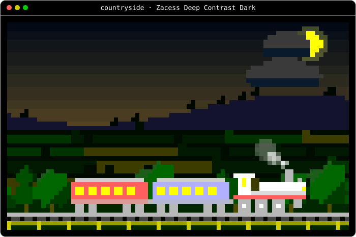

A steam train crossing open country on a golden evening, seen from beside the line and painted in
solid pixels. The view keeps pace with the train, so the land slides past in layers at different
speeds: far hills with small trees on the crest slowest, then a patchwork of grass, pasture and
wheat fields between hedgerows with gaps at the gates, in bands that grow taller and faster as they
come nearer, then rounded oaks and tiered pines beside the line, the track with its sleepers at 2.5
columns a second (`TRACK_SPEED`) and a fence right in front, fastest of all. The scenery is worked
out from where it is in the world, so it never repeats and needs nothing stored. A still sun sits in
a soft glow at the top right and a few clouds drift slowly the other way. The train is an engine
with a chimney, a dome, a cab with a lit window, a lamp, a red frame and three driving wheels,
pulling up to four carriages with lit windows on two bogies. It eases forward and back a little over
a minute. Smoke puffs from its chimney every 0.8 seconds, drifting back and up and swelling through
three sizes as it fades, one size a second (`PUFF_STAGE`); only the dense middle of a puff stands
out, its thin edge stays imagery.

- Colours: the engine in the text colour with a red frame, carriages in red and bright blue, windows
  and the lamp in bright yellow, wheels and rails in grey, the fence in yellow, smoke in the text
  colour and the sun in bright yellow. The sky, clouds, hills, fields, hedges, trees, ballast and
  sleepers are tints of the background below the non-text floor, so the train stands out in front of
  them.
- Light themes: a clear day instead of an evening. The sky is blue, paling towards the horizon, the
  clouds are the background colour with a blue shade along their base and the sun is a pale disc in
  a warm glow rather than a bright yellow one.
- Small screens: carriages fill up to seven tenths of the width, so at 20 columns only the engine
  runs. The sun needs 40 by 14 and smoke needs 7 rows. Clouds are smaller below 20 rows.
- Reduced motion: every layer slides at half speed and the clouds drift at half speed; smoke puffs
  half as often, rises at half speed and grows half as fast.
- Tests: the train stays wholly in view over two simulated minutes at the lively level while the
  land moves on; the engine, its frame, its window and both carriage colours are drawn, the rails
  run the whole width and a fence post is drawn; the puff stage is at least a third of a second; the
  engine alone at 20 by 8; the sprites are rectangular with the chimney where the smoke starts; the
  land and trees stay apart and below the ceiling in every theme and the train, fence and rails keep
  the floor apart from the land and sky; the 256 colour table keeps the land and the train apart;
  the shared pixel checks pass.

## winter-cabin

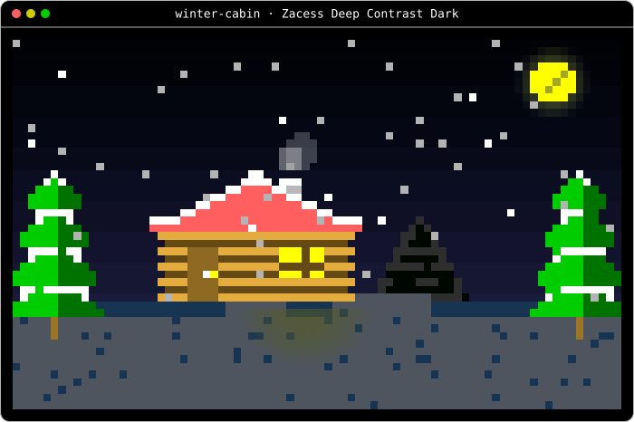

A log cabin in a snowy clearing at night, painted in solid pixels: log walls with dark lines between
the logs and round ends at the corners, a roof with snow lying along its slopes and eaves, a stone
chimney with smoke curling from it, a door with a lit handle and a lit window split into four panes
whose light spills onto the snow in front. The smoke leans to the right on a light breeze and swells
through three sizes as it fades, one stage every 1.2 seconds (`PUFF_STAGE`), with a new puff every
1.1 seconds. Pines drawn in tiers of branches, shaded on one side with snow resting unevenly on each
tier, stand along the edge of the clearing, with two tall ones in front at the sides. Snow falls
gently at two depths, swaying a little, onto drifts with blue shadow in their hollows. A full moon
with a soft halo and a few stars hang above the trees.

- Colours: the logs a warm brown between yellow and red, the roof in red, the window in bright
  yellow, the chimney and smoke in grey, near pines in green, the snow on the roof, the pines and in
  the air white, the moon in bright yellow and stars in the muted colour. The sky, the far pines,
  the snow on the ground and the window's light on it are tints of the background below the non-text
  floor.
- Light themes: the same clearing on a winter afternoon. The sky is a pale blue with no stars and
  the moon is a faint white daytime moon. The logs are yellow and the lit window is a pale warm pane
  against them. Snow on the roof and the pines is the pale snow of the ground; the falling snow is
  white, each near flake with a soft cool edge so it still shows over the lying snow. Far flakes are
  a soft blue.
- Small screens: below 40 by 16 a smaller cabin with a lit window and no glazing bars; the tall
  pines need 30 by 10 and the moon 40 by 14.
- Reduced motion: snow falls and sways at half speed, smoke rises and drifts half as fast, grows
  half as fast and puffs every 2 seconds instead of every 1.1.
- Tests: the window, logs, roof, roof snow, chimney and pines are drawn, smoke rises above the
  chimney and the puff stage is at least a third of a second; snow never falls below the ground over
  thirty seconds at the lively level; the small cabin with its lit window at 20 by 8 and the large
  one at 80 by 24; the sky, snow, far pines and the window's light stay apart and below the ceiling
  in every theme; at night the flakes and window keep the floor, by day the flakes, their edge and
  the moon are imagery apart from the sky; the logs, roof, pines and chimney keep the floor apart
  from the sky and snow; the 256 colour table keeps the snow, sky, far pines, window and logs apart;
  the shared pixel checks pass.

## autumn

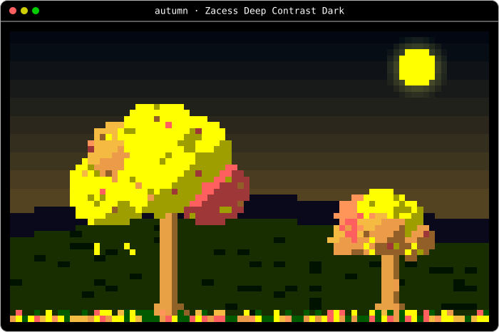

A tree in full autumn colour on a warm evening, painted in solid pixels: a trunk that flares into
roots and branches, thicker where they leave the trunk, up to several rounded clusters of leaves.
They make a solid crown in red, orange and gold, lit from the upper left and shaded underneath, with
a leaf of another colour here and there and a few leaves set deeper in its shade. A smaller second
tree stands on a wide screen. A few leaves at a time let go and drift down on the breeze, each a two
pixel shape tumbling through four turns, with each turn lasting 0.6 seconds (`LEAF_TURN`). They
settle into a pile along the ground that starts as a thin scattering, stays rounded (a leaf landing
on a heap slides to the lower side) and never grows past four pixels, two rows. Now and then a skein
of seven geese crosses the sky in a V from right to left, past a still low sun, far hills and a
meadow.

- Colours: leaves in red, an orange between red and yellow and bright yellow, each lit towards
  bright yellow and shaded towards the theme's darkest colour; the trunk and branches a warm brown
  between yellow and red; geese in the text colour; the sun in bright yellow in a soft halo. The
  sky, hills, meadow and grass are tints of the background below the non-text floor.
- Light themes: a clear afternoon instead of an evening, with a blue sky paling to a warm horizon
  and a pale sun in a warm glow rather than a bright yellow disc. The trunk and branches are the
  theme's yellow.
- Small screens: the pile is two pixels deep below 12 rows; below 10 rows there are no hills, only a
  meadow across the lower half; geese need 30 by 12, the sun 40 by 14 and the second tree 60 by 14.
- Reduced motion: leaves fall, drift and come loose at half the rate (every 1.6 to 3 seconds instead
  of 0.6 to 1.4) and fall without turning; the geese fly at half speed.
- Tests: the turn period holds; over ten simulated minutes at the lively level leaves settle, the
  pile never passes its cap and no leaf of the pile shows above its rows; the bark is drawn; the
  tree's leaves and bark are drawn at 20 by 8; the sky, hills, meadow and grass stay apart and below
  the ceiling in every theme; the leaves, bark, geese and a dark theme's sun stand apart from the
  sky and meadow, with the bark, geese, red and gold leaves at the floor; the 256 colour table keeps
  the hills, sky, meadow and leaves apart; the shared pixel checks pass.

## blossom

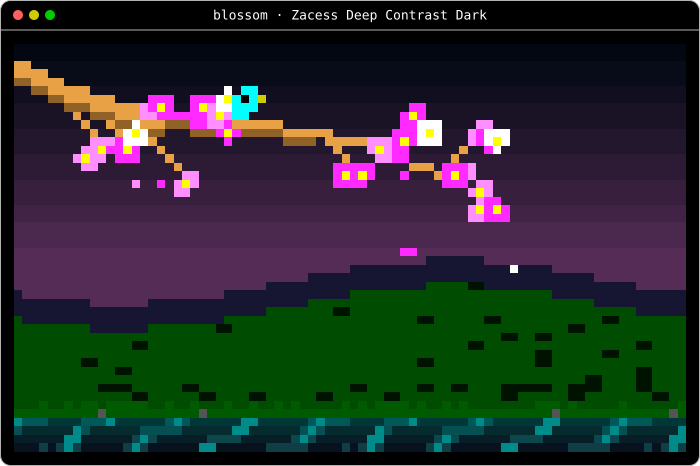

A flowering branch reaches in from the top left corner and droops across a spring evening sky with a
pink haze, painted in solid pixels. It reaches about two thirds of the way across and droops more on
a tall screen. It tapers from three pixels thick to one, shaded along its underside, with short
twigs up or down every few columns. Each twig ends in a cluster of one to three flowers, each a
bright centre with four petals around it and a paler blush between them so it reads as round. More
flowers grow along the branch itself and at its tip. A few petals at a time let go on a spring
breeze and tumble slowly down, turning between flat and edge on every 0.7 seconds (`PETAL_TURN`),
past far hills and a meadow to a pebbled bank and a stream with drifting ripples. Each petal settles
at its own depth on the stream and floats off flat to the right. A small bird with a wing, an eye
and a beak sits on the branch clear of the twigs and turns to face the other way every six seconds
(`BIRD_LOOK`).

- Colours: petals in magenta, bright magenta and the text colour, the centres in bright yellow; the
  branch a warm brown between yellow and red; the bird in bright cyan with a bluer wing, a yellow
  beak and an eye in the background colour. The sky, hills, meadow, bank, pebbles and stream are
  tints of the background below the non-text floor.
- Light themes: a clear spring day with a blue sky paling to a faint pink at the horizon. The
  blossom is a clear mid pink in the hues of magenta, bright magenta and bright red, with deeper
  pink centres in place of yellow and a paler pink blush; the branch is the theme's yellow.
- Small screens: the bird needs 30 by 10. Below 10 rows the stream is one row and the hills and
  meadow are left out.
- Reduced motion: petals fall, drift and float at half speed without turning and come loose every
  1.6 to 3 seconds instead of 0.6 to 1.4; the ripples drift at half speed and the bird looks half as
  often, every 12 seconds.
- Tests: the petal and bird periods hold at every motion setting and the bird's sprite mirrors
  cleanly; over a simulated minute petals reach the stream and float, never below it; the flower
  centres, the bird, the branch and the ripples are drawn; flowers at 20 by 8; the sky, hills,
  meadow, bank and stream stay apart and below the ceiling in every theme; the petals and centres
  keep the floor at night and stay solid by day, the branch and bird keep the floor and all of them
  stand apart from the sky and stream; the 256 colour table keeps the hills, sky, stream, bank and
  meadow apart; the shared pixel checks pass.

## city-night

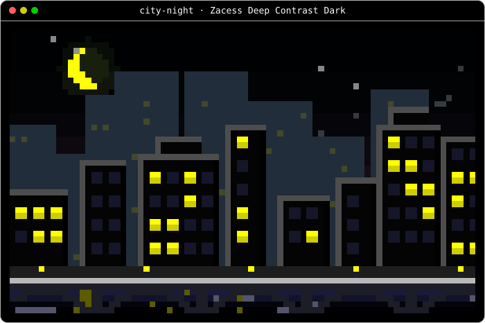

A night skyline painted in solid pixels. The sky darkens upwards from a glow along the horizon. A
hazy far skyline with a few still, dim windows stands taller behind a row of near buildings, each
lit along its left edge and roof line and shaded along its right, some with an antenna and a red
light, a stepped top or a water tank. Their windows are two pixels square, each filling one cell row
with wall between them: one at a time lights up or goes dark, every 1.2 seconds (`WINDOW_PERIOD`). A
crescent moon with its dark side faintly showing and a faint halo hangs among stars. A river runs
along the bottom below a quay, with slow ripples, a column of moonlight and broken streaks from the
lit windows. On a screen with room an arched bridge on piers, with lamps along its deck, carries a
lit train of two to four carriages across now and then, every 15 to 35 seconds, at 9 pixels a
second, from either side.

- Colours: the sky, both skylines, the quay, the river, its ripples and its reflections are tints of
  the background held below the non-text floor; the lit windows in yellow and bright yellow, the
  moon in bright yellow, the deck in grey, the train in red with bright yellow windows and the
  antenna lights in red keep the theme's floor. On a dark theme the near buildings are darker than
  the haze behind them.
- Light themes: the city at dusk. The sky is a fading blue with no stars to see, the moon is a pale
  white crescent with no dark side or halo and the near buildings are the strongest shapes. Unlit
  panes are dark glass, just solid, so the towers keep their outline, while the lights coming on are
  a soft warm glow, lighter than the wall around them; the lamps on the bridge share it.
- Small screens: the moon needs 30 by 12, the river 10 rows and the bridge and train 30 by 14.
- Reduced motion: windows change half as often, the ripples move at half pace and show less and the
  train runs at half speed and comes every 30 to 60 seconds.
- Tests: at most one window changes at a time and no more often than `WINDOW_PERIOD` at any motion
  setting; windows sit on even pixel rows so each fills whole cells; every theme keeps its tints
  below the ceiling, a dark theme's windows, moon and train at the floor and clear of the walls and
  a light theme's train at the floor, its dark glass solid and its lights and moon pale imagery
  apart from the walls; every theme paints the sky, both skylines, lit and dark windows, the moon
  and the deck in 15 to 120 colours with river along the bottom row; the 256 colour table keeps the
  walls, windows, river and moon apart; a train crosses an 80 by 24 screen within a minute and never
  a 20 by 8 one; the sprites are rectangular; the shared pixel checks pass.

## orbit

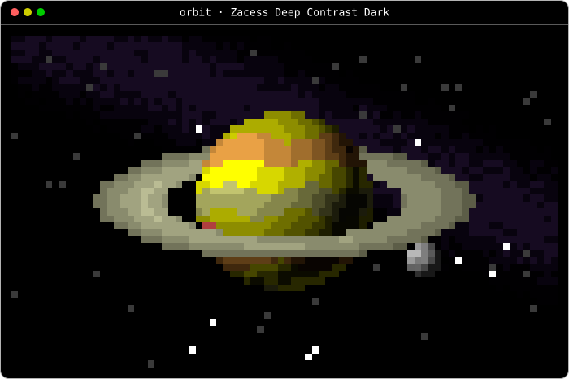

A banded gas giant painted in solid pixels and lit from the upper left, shaded smoothly from its
bright limb to a dark night side, with a little light wrapping round its edge so the night side
keeps its round outline. Its band edges are wavy and a storm crosses its face once a minute. A broad
tilted ring circles it, brightest a little in from its inner edge and dimmer on the side away from
the sun, passing behind the planet at the top and in front of it at the bottom; on a large planet a
gap shows in it. A small moon, shaded by the same light, with two craters once it is large enough,
goes round once every 40 seconds (`ORBIT_PERIOD`), passing in front of the planet and hiding behind
it. Distant stars of two brightnesses and a faint diagonal band of haze fill the sky.

- Colours: the planet's bands in yellow, bright yellow, a yellow and red mix and a yellow and muted
  mix with the storm in red, each shaded towards the theme's darkest colour; the ring from the muted
  colour and yellow; the moon in grey; bright stars in the text colour; the haze and the faint stars
  are tints held below the non-text floor.
- Light themes: the planet is a bright illustration on the pale sky. Its bands lean towards gold,
  rust, pale gold and a cool grey brown, lifted to mid tones that are only just solid, with the
  night side a deeper shade of the same rather than a dark one. The ring is a pale icy imagery tint,
  lighter than the planet it crosses. The stars are a few soft blue grey points below the floor.
- Small screens: the planet's size follows the screen, down to a few pixels across at 20 by 8; the
  ring's gap shows only once the planet is large enough to draw it cleanly and the moon's craters
  only once the moon is large enough.
- Reduced motion: the moon and the storm move at half speed, one orbit every 80 seconds.
- Tests: the moon turns well under a tenth of a turn a second even on lively and spends time both in
  front of and behind the planet; in every theme and at three sizes the planet is lighter on its lit
  side, takes at least a dozen shades and has its ring on both sides; the haze and faint stars stay
  below the ceiling; at night the bands, storm, moon and stars keep the floor and on a light theme
  the bands, storm and moon stay solid while the stars and ring stay imagery, the ring apart from
  the bands; neighbouring bands, the storm, the ring and its gap stay apart; the 256 colour table
  keeps the lit and night sides apart and the ring off the background; the shared pixel checks pass.

## constellations

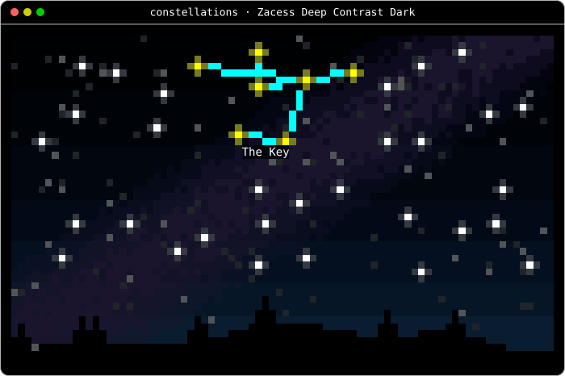

A night sky painted in solid pixels, deepening upwards, with a faint band of the galaxy across it
and faint stars of two brightnesses. A low line of wooded hills, with a small pine standing up on
the crest here and there, closes the bottom of the sky as a soft silhouette. Brighter stars, each
with a soft cross of glow, sit in groups, one group to each box of the sky above the hills, so no
two figures overlap. One group at a time is joined into a figure: each new star is joined to its
nearest neighbour, the lines are drawn at nine pixels a second, one pixel a step, stopping short of
each star. While the figure is drawn, held and faded its stars show in bright yellow. The finished
figure is held for six seconds with its lines in bright cyan. The figure's name, such as The Kettle
or The Heron, shows as text for as long as the figure does, beneath it unless the figure is at the
bottom of the screen, where it sits above. It then fades in two steps 1.2 seconds apart
(`FADE_STEP`), its lines turning back to cyan and then grey before they go. The sky then rests for a
moment before the next group. Every name is made up for the scene.

- Colours: the sky, the galaxy, the faint stars and the hills are tints held below the non-text
  floor; the stars of every group in the text colour, the joined stars in bright yellow and lines in
  cyan, then bright cyan while held, then grey as they fade. The name is in the text colour while
  the figure is held and the muted colour while it is drawn or fades, on the sky behind it when it
  keeps the theme's floor there (switching to the text colour if that is what it takes) and on the
  theme's background otherwise.
- Light themes: the same sky at the blue hour, deep blue overhead and paling towards the horizon,
  with the stars pale white imagery and the joined stars a warm white. The lines keep the floor over
  them and the hills are a dark, solid line of woods that carries the outline.
- Small screens: the sky is split into one box per group, so a 20 by 8 screen has one small figure;
  the hills need 12 rows.
- Reduced motion: lines are drawn at half speed and the hold and fade steps take twice as long.
- Tests: figures are drawn, named and faded one at a time over two minutes at the lively level, with
  the fade step at least `FADE_STEP`; every line is one pixel a step and leaves its stars out; the
  name keeps the floor on the sky in every theme; the sky, galaxy and faint stars stay below the
  ceiling and apart; at night every star and line keeps the floor and at the blue hour the stars are
  imagery apart from the sky while the lines keep the floor and the hills stay solid; the held and
  fading lines stay apart; a small sky still has a figure; the shared pixel checks pass.

## tea

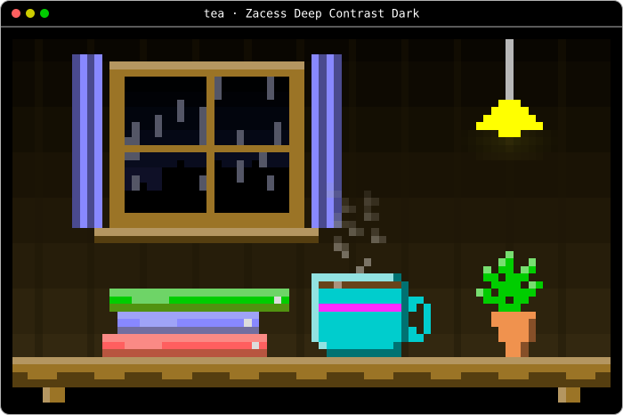

A warm room painted in solid pixels, its wall striped faintly every seven columns and brightest near
the table. A shaded mug of tea with a lit side, a painted band, a glint on the tea and a handle sits
on a wooden table, steam rising from the middle of the cup in soft wisps that sway a pixel or so
either way every 2.4 seconds (`SWAY_PERIOD`) as they rise, each growing from a single pixel to a
small cloud and thinning before it goes after five seconds. Beside the mug lie a stack of three
books, a little out of line with their page edges showing. A potted plant stands on the other side.
Above them hangs a lamp on a cord with a faint, still halo. Behind, a curtained window with a frame,
glazing bars and a sill shows the evening outside, with rain in short streaks or snow drifting
sideways, picked at the start, falling over rooftops and chimneys.

- Colours: the wall, its stripes, the glass, the rooftops and the rain are tints held below the
  non-text floor; the mug in cyan with a magenta band and tea in a dark yellow and red mix, the
  table and window frame in a dark yellow and red mix, the curtains in blue, the books in red, blue
  and green, the plant in green with a red and yellow pot and the lamp in bright yellow keep the
  theme's floor or are shaded from colours that do. The steam is paler than the wall in every theme:
  the page's own background colour on a light theme.
- Small screens: below 40 by 14 the mug is a smaller one and the books, plant, lamp and table legs
  are left out; the window needs 30 by 12, the lamp needs room beside the window and the plant room
  beside the mug.
- Reduced motion: steam rises and sways at half speed with half as many puffs and the weather falls
  at half speed.
- Tests: the sway period holds at every motion setting, so a puff crosses a column at most twice a
  sway; at 80 by 24 the mug and tea are drawn, at least three puffs rise above the mug and close to
  it and the steam shows against the wall; the window, curtains, books, plant and lamp are drawn at
  80 by 24 and the window is left out at 20 by 8 while the mug stays; the wall, glass, rooftops and
  rain stay below the ceiling and apart, the steam apart from the wall, the table, mug, band, plant
  and curtains apart from what they sit on; the mug, lamp, leaves and books keep the floor and each
  book stands apart from the table; the sprites are rectangular; the shared pixel checks pass.

## cat-nap

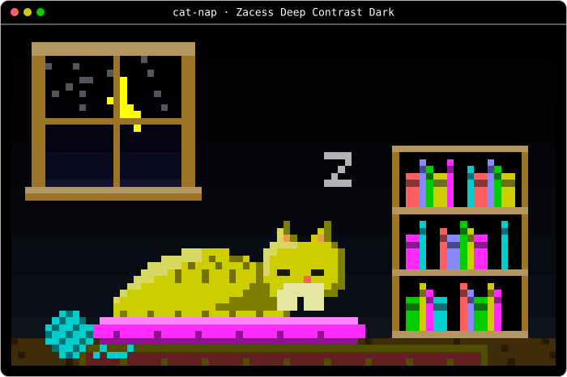

A ginger tabby painted in solid pixels and lit from the upper left, curled up asleep on a plump
tufted cushion with its head on its paws, eyes shut, ears up and its tail along the front. Its back
rises by a pixel and falls again with each four second breath (`BREATH_PERIOD`) and the tip of its
tail flicks out a pixel for a moment once every seven seconds (`TAIL_PERIOD`). Every three seconds a
z drifts up and to the right from it, growing from a small z to a large one and fading over its last
quarter. A night window with glazing bars, a still crescent moon and stars hangs on the wall and a
ball of wool with a loose end trailing towards the cushion lies on a patterned rug over floorboards.
On a wide screen a bookcase stands against the right wall. On a large screen the cat, its cushion,
the wool, the window and the z's are drawn at twice the size.

- Colours: the wall, floor, rug and night sky are tints held below the non-text floor; the cat in
  yellow, lit and shaded, with darker stripes, a pale muzzle and paws and a red nose; the cushion in
  magenta; the z's in the muted colour; the wool in cyan; the moon in bright yellow; the window
  frame and bookcase in a dark yellow and red mix with spines in six colours.
- Light themes: the window shows a blue daytime sky with no stars and the moon is a pale disc in the
  background colour; the wall is a warm tint that pales downwards instead of a cool one lit from
  below.
- Small screens: below 40 columns a smaller cat is drawn; the window needs 36 columns, the wool 40
  and the bookcase 70 by 16; the double size needs 110 by 40.
- Reduced motion: breaths, the tail and the z's all take twice as long and the z's drift at half
  speed.
- Tests: the breath and tail periods hold at every motion setting; the back changes shape once or
  twice a breath and no cell of the sleeping cat changes more than twice a second; a z drifts up
  from the cat and the fur, stripes, eyes, nose, cushion and wool are drawn; the cat and both ends
  of its cushion fit a 20 by 8 screen; the wall, floor, rug, glass and stars stay below the ceiling
  and apart; the cat stands apart from its cushion and the wall, the cushion and wool from the rug
  and a z from the wall; the fur, cushion, wool and z's keep the floor, as does a dark theme's moon,
  while a light theme's moon stays apart from its sky; the shared pixel checks pass.

## garden

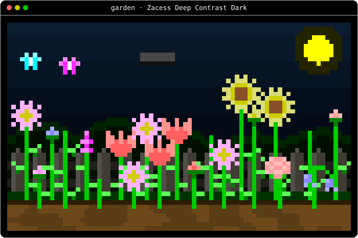

A flower bed of tulips, daisies, sunflowers, bluebells, lavender and roses painted in solid
pixels, planted in two staggered rows in dark soil. Behind it a strip of lawn runs up to a picket
fence of pointed pickets on two rails, lit from the left, with a rounded hedge behind the fence.
Above is a summer sky gradient with a still sun in a soft halo and a few clouds drifting slowly
across, with butterflies wandering over the bed. Over a 110 second season (`SEASON`) each seed
waits under the surface, sprouts two round seed leaves and its stem climbs a pixel at a time
with leaves on alternating sides along its lower part. A green bud forms with its petal colour
showing at the tip and the flower opens. At 84 percent of the season (`FALL_START`) the petals
drift down and from 92 percent (`SETTLE_START`) the stems settle back into the soil, then the bed
starts again. The first season opens half way through, so the bed is already in flower when the
scene appears. Each plant's state comes from the season's clock, so a resize keeps the season
where it was.

- Colours: the sky, clouds, hedge, fence, lawn and soil are tints held below the non-text floor;
  stems in green and leaves in bright green, the sun in bright yellow, tulips in red, daisies in
  bright magenta with yellow centres, sunflowers in yellow with dark centres, bluebells in blue,
  lavender in magenta, roses in bright red and the butterflies' wings in magenta, bright cyan and
  yellow with bodies in the theme's strongest text colour.
- Light themes: the sun is a clear pale gold lifted from the theme's yellow instead of its bright
  yellow and the sunflowers are that gold darkened only as far as a solid shape needs, since a
  light theme's own yellow is close to brown. The sky, hedge, lawn and fence take their own tints.
- Small screens: the sun needs 30 columns and 10 rows, the clouds and the butterflies 10 rows and
  the fence and hedge 12 rows; one butterfly per 40 columns, up to six.
- Reduced motion: the season takes twice as long, wings beat half as often and the clouds and
  butterflies move at half speed.
- Tests: a season grows, blooms, sheds its petals and starts again; every plant blooms before the
  petals fall at every size; a stem takes at least a second a pixel and a butterfly's wings never
  beat faster than `FLUTTER_PERIOD` at every motion setting; at least five blooms show in every
  theme; the backdrop tints stay below the ceiling and the sky, fence, hedge, soil, lawn, stems,
  petals, wings and sun stay apart in every theme; the shared pixel checks.

## tiles

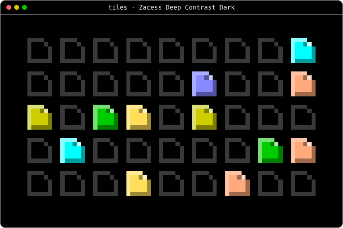

A grid of small pages painted in solid pixels over a soft backdrop that fades from a faint tint of
the accent colour at the top to the background at the bottom. Each page has the Zacess mark's
folded corner. About a third are filled in one of ten colours from the theme, lit along their top
and left edges, shaded along the others and with the fold turned back in a paler shade with a
small shadow under it; the rest are drawn as faint outlines with the fold's diagonal closing the
corner. Every few seconds one tile takes a new colour, fills or settles back to its outline: every
three seconds on a small grid (`CHANGE_PERIOD`), more often on a larger one and never more often
than every 0.7 seconds (`MIN_CHANGE_GAP`). The grid drifts back towards a third filled, so it
never becomes a wall of solid colour or empties.

- Colours: filled tiles in the accent colour, cyan, magenta, green, yellow, blue, bright cyan and
  the keyword, string and function colours; the backdrop, the outlines and their insides are tints
  held below the non-text floor.
- Small screens: tiles are four pixels square, six from 40 by 12 and ten from 120 by 40; a margin
  is kept on screens of 40 by 12 and more.
- Reduced motion: tiles change half as often.
- Tests: at most one tile changes at a time and the gap is never below `MIN_CHANGE_GAP` at every
  size and motion setting; the grid stays between 15 percent and three fifths filled over ten
  minutes on lively, shows both filled tiles and outlines and never runs off the screen; every
  tile has its fold; the backdrop, outlines and insides stay below the ceiling and every fill
  keeps the floor and stands apart from the outline in every theme; the shared pixel checks.

## ribbons

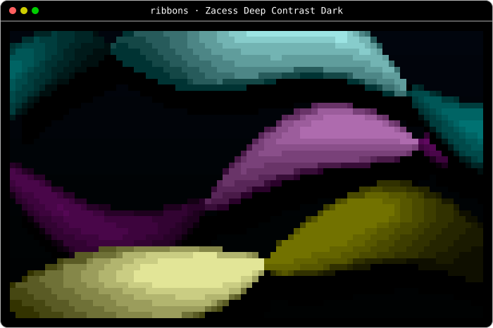

One to six broad ribbons of silk painted in solid pixels over a soft backdrop gradient, wide
enough that between them they fill much of the screen. Each ribbon follows two slow waves added
together, so its shape keeps changing. It twists as it goes: it narrows where it turns edge on
(never thinner than a thread) and shows its darker back before turning again. The light comes
from the upper left, so each fold has a lit face, a sheen just above the middle and a shade on its
far side, with a rim a step deeper along the edges. Every other ribbon sits further back, paler
and a little narrower. Each ribbon casts a soft shadow below and to the right onto whatever lies
behind it. No crest or twist travels sideways faster than four columns a second (`MAX_DRIFT`).

- Colours: the ribbons in cyan, magenta, yellow, blue and green, shaded from their folds to their
  sheen; the backdrop and the cast shadows are tints held below the non-text floor and a shadow
  falling on a ribbon further back is a deeper tone of that ribbon.
- Light themes: the folds deepen and the sheen pales towards the background, as silk looks in
  daylight, where a dark theme's folds sink towards the background and its sheen rises; the
  backdrop deepens towards the bottom and the cast shadow is a cool grey.
- Small screens: one ribbon for every 8 rows, from one to five, each about four tenths of its
  share of the height in half width.
- Reduced motion: the ribbons flow and twist at half speed. Lively adds a ribbon, except under
  reduced motion.
- Tests: no crest or twist drifts faster than the limit at any motion setting; every column
  crosses each ribbon and the ribbons fill at least a third of the frame; the backdrop and
  shadows stay below the ceiling, every ribbon colour keeps the floor and the front and back of a
  ribbon and neighbouring ribbons stay apart in every theme; the shared pixel checks.

## sunflower-field

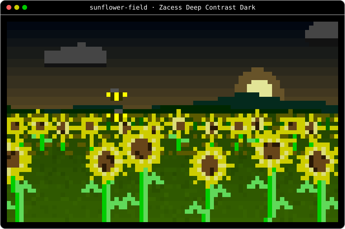

A sunflower field painted in solid pixels. The sky is cool overhead and warms towards a still,
low sun in a halo over two lines of hills, the far one hazier and higher; two clouds drift across
it. The field deepens in colour towards the front, grained with tufts and a scatter of distant
heads near the horizon. Three rows of sunflowers stand at different depths: a distant row of
small heads, a middle row and a tall front row whose heads have dark seeded centres, rays that
catch the light and leaves arching off the stems. The wind passes along the field as a slow wave,
so neighbouring flowers lean one after another, the front row furthest. One sway takes about ten
seconds (`SWAY_RATE`) and the roots never move. Striped bees drift on slow loops between the
heads, facing the way they fly, passing in front of the middle row and behind the front one.

- Colours: the sky, sun halo, clouds, hills, field and farthest row are tints of the background
  below the non-text floor; the petals in yellow with lighter rays, the dark centres, the stems
  and leaves in green and the bees in bright yellow keep the floor.
- Light themes: the sky is a deeper blue overhead and pales towards the horizon, the sun is the
  palest thing in it (the background colour) where a dark theme's sun glows yellow, the lit rays
  are a clear gold of the theme's yellow hue and the bees' wings are the background colour.
- Small screens: below 8 rows only the front row grows and the bees are left out; the clouds need
  10 rows and the sun 20 columns and a horizon 8 pixels down; flowers grow larger on taller
  screens.
- Reduced motion: the sway is slower and smaller and the bees and clouds drift at half speed.
- Tests: one sway takes at least eight seconds; the roots never move while the heads lean no
  further than their row allows and the front row does lean; the bees stay over the field; the
  petals, centres, stems and sky show in every theme; the imagery stays under the ceiling, the
  petals, stems and bees stand apart from the field and the sky and every band stays apart in
  every theme and in 256 colours; the shared pixel checks.

## mountain-lake

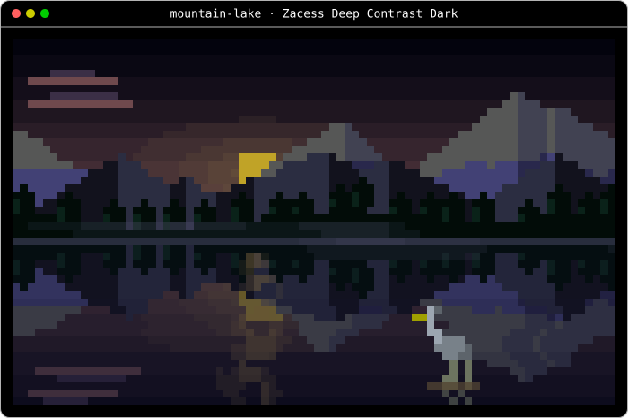

A mountain lake at first light, painted in solid pixels. The sky runs from a cool blue overhead
to a dawn glow on the horizon, where the sun's rim shows through the lowest notch of the peaks
across the middle of the view and thin bands of cloud, lit underneath and shaded on top, drift
slowly across. Three ranges stand behind one another: a far range and a middle range with faces
turned to the sun lit and the others shaded, snow above a ragged line on each, then low hills
along the far shore topped with a line of pines. The lake mirrors all of it, a little darker and
bluer in steps with depth, with a pale line along the shore and mist lying low over the water,
drifting slowly. The sun's light lies on the water as a soft column broken by the swell. A gentle
swell always bends the reflection and every 14 seconds (`RIPPLE_PERIOD`) a band of stronger
bending travels out from the shore at 2.2 pixels a second (`RIPPLE_SPEED`). A grey heron stands
in the shallows with its reflection beneath it. Every 8 to 14 seconds it stretches its neck down
to the water and holds it there for four to seven seconds, never changing pose sooner than three
seconds (`HERON_HOLD`). Each time a ring spreads from its beak (`RING_GROWTH`) and fades over five
seconds.

- Colours: the sky, the dawn glow, the cloud bands, the mountains and their snow, the forest, the
  water, the mist and the light on the water are tints of the background below the non-text
  floor and the whole reflection, the heron's included, is held below it too; the heron in a grey
  mixed from the muted and info colours with a lighter neck, a dark crest and flight feathers, a
  yellow beak and yellowish legs keeps the solid floor, as does the sun's rim on a dark theme.
- Light themes: a pale dawn instead of a warm glow out of the dusk; the ranges darken as they come
  nearer instead of the nearest being darkest; the snow, the mist, the light on the water and the
  sun's rim are the background colour, so the sun is the palest thing in the sky and the heron
  alone carries the outline.
- Small screens: no heron below 24 columns or when the lake is under 8 pixels deep; a small heron
  until the screen is 28 rows tall with a lake 22 pixels deep; the heron is drawn at double size
  from 75 rows; the cloud bands need 10 rows, one for every 40 columns, two to six.
- Reduced motion: the ripple, the swell, the mist and the cloud bands move at half speed and the
  heron holds each pose twice as long, so its rings come half as often and spread more slowly.
- Tests: the heron is drawn and never changes pose sooner than `HERON_HOLD` over two minutes; a
  short screen drops the heron and still draws the lake; the heron's sprites are rectangular and
  its two poses the same height; the imagery stays under the ceiling, the heron keeps the solid
  floor and the far and middle ranges, the middle range and the forest and the heron's neck and
  crest stay apart in every theme; the shared pixel checks.

## tide-pools

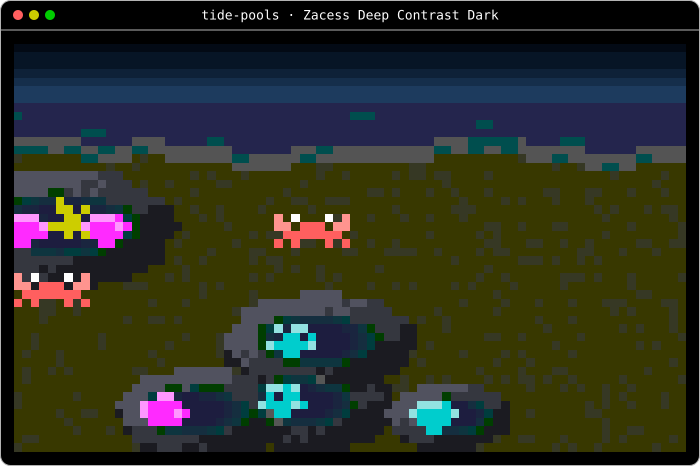

A rocky shore at low tide, painted in solid pixels. The sea has drawn back to a strip under a pale
sky, shimmering as it moves, with broken foam along its wavy edge. Rocks lit from the upper left
lie across the wet, grainy sand, each with a lit face, a body and a shaded side. The larger ones
hold pools whose water deepens towards the middle, with light shimmering over it
(`SHIMMER_RATE`) and weed fringing the rim. A small pool holds one anemone and a larger one two,
often with a starfish resting between them. Anemones wave their tentacles, one wave about every
five seconds (`WAVE_RATE`). Crabs with raised claws and eyes on stalks walk sideways across the
sand and rocks for two to six seconds at a time, rest for a moment, sometimes turn round and turn
back wherever a pool, the sea or the edge of the screen is in their way. Each leg position holds
for 0.4 seconds (`CRAB_STEP`).

- Colours: the sky, sea, foam, sand, rocks, weed and pool water and its glints are tints of the
  background below the non-text floor; the crabs in red with stronger claws and eyes in the text
  colour, the anemones in magenta and cyan with stronger tips and the starfish in yellow keep the
  floor.
- Light themes: the foam and the glints on the pools are the background colour, the sky pales
  towards the sea instead of brightening and the rocks are shaded the other way round, darkest on
  the side away from the light.
- Small screens: smaller crabs and three arms on each anemone instead of five below 20 rows; no
  crabs when the beach is too short or too narrow for two of them side by side; up to 14 rocks
  and up to four crabs on a large screen.
- Reduced motion: the shimmer is slower and sparser, tentacles wave less and more slowly and crabs
  walk at half speed and rest twice as long.
- Tests: no crab ever stands in a pool or the sea over a minute and a half at the lively level and
  the crabs do walk; legs change no more than two and a half times a second and one wave takes at
  least five seconds; the crabs, rocks, pools, sea and anemones are drawn; the imagery stays under
  the ceiling, the crabs, claws, anemones and starfish stand apart from the sand, rock and water
  and every band stays apart in every theme and in 256 colours; the shared pixel checks.

## paper-boats

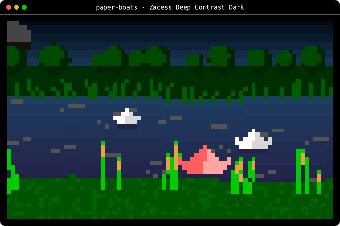

A stream between two grassy banks, painted in solid pixels. Round trees lit from the left line the
far bank under a sky with two drifting clouds. The water is pale where it mirrors the sky and
deeper towards the near bank, while ripples ride the current downstream. Folded paper boats in
five colours drift with it at three distances, the nearest largest and quickest at the speed of
the current (`FLOW`), each with a lit and a shaded side, a shadow under the hull and a short wake
trailing upstream. They bob a pixel up and down every six seconds or so (`BOB_RATE`) and come
round again from the left once they leave. Short reeds sway along the far bank and near clumps of
taller reeds, some with cattails, stand in front of the water with gaps between them so the boats
show through (`REED_RATE`).

- Colours: the sky, clouds, banks, trees, water, ripples and far reeds are tints of the background
  below the non-text floor; the boats in the text colour, yellow, cyan, magenta and red, each with
  a stronger fold, the near reeds in green and the cattails in a yellow and red mix keep the
  floor.
- Light themes: the first paper colour is bright blue instead of the text colour, which would read
  as ink, not paper; the ripples and the wakes are the background colour and the far trees are
  shaded darker instead of lighter.
- Small screens: the largest boats need about 19 rows of stream and the middle size about 12, so a
  short screen gets only small boats; no reeds below 8 rows and no clouds below 12.
- Reduced motion: boats, ripples and clouds drift at half speed, ripples are a little sparser and
  the reeds sway less and more slowly.
- Tests: no boat moves faster than the current at the lively level or leaves the water over two
  minutes and boats come round again; boats, reeds and water are drawn; every boat has a fold;
  the imagery stays under the ceiling, the boats, folds and reeds stand apart from the water and
  every band stays apart in every theme and in 256 colours; the shared pixel checks.

## windmills

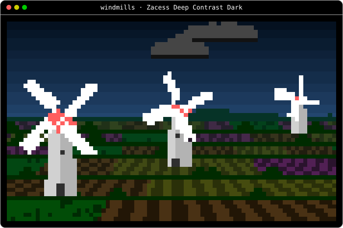

Tower mills in a row from near to far over open country, painted in solid pixels. Low hills sit
on the horizon under a sky with clouds drifting across it. The fields in front form six bands
that widen towards the front, a patchwork of grass, wheat, ploughed earth and flowers whose edges
and furrows run towards a vanishing point in the middle of the horizon, with hedges and the odd
tree along the top of each band and the farther bands fading into the haze. Each mill has a
tapering tower lit on the left, a door and a window on the larger ones, a rounded red cap and four
latticed sails of pale cloth turning slowly, one turn every sixteen seconds or so (`SAIL_TURN`).
A big mill on a large screen turns more slowly, so no sail tip sweeps faster than six pixels a
second (`MAX_TIP_SPEED`).

- Colours: the sky, clouds, hills, fields, furrows, hedges and sail cloth are tints of the
  background below the non-text floor; the towers in the muted colour (stepped towards the
  background where the muted colour is close to the text colour, as on Warm Dark), the caps in
  red and the sail frames in the text colour keep the floor.
- Light themes: the sky pales towards the horizon, the hedges are darker than the fields instead
  of lighter, the furrows are a deeper tint and the sail cloth is a pale tint of the tower instead
  of a pale tint of the text colour.
- Small screens: no mills below 6 rows or 16 columns; one mill for every 26 columns, two to five;
  sails under 12 pixels long are solid with no lattice and under 5 pixels the spars are drawn
  alone; the clouds need 8 rows.
- Reduced motion: sails turn and clouds drift at half speed.
- Tests: one turn takes at least fifteen seconds; nearer mills stand lower and taller and the row
  runs left to right; every sail turns and no sail tip sweeps faster than the limit at the lively
  level; towers, caps and sails are drawn; the imagery stays under the ceiling, the towers, caps
  and sails stand apart from the sky and fields, the sails from the towers and every band stays
  apart in every theme and in 256 colours; the shared pixel checks.

## picnic

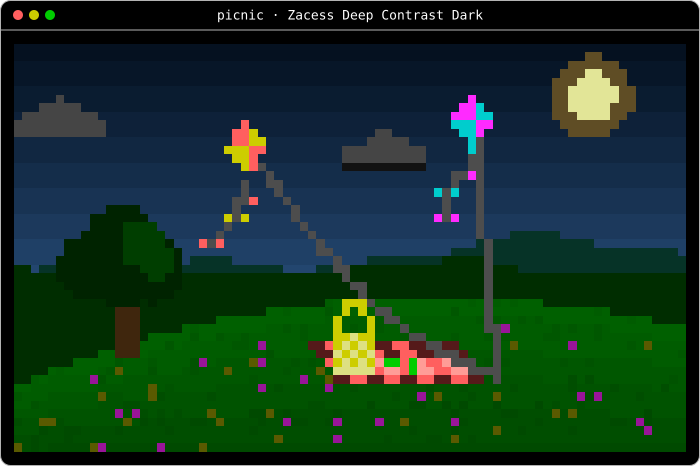

A picnic on a hill, painted in solid pixels. A still sun in a halo sits high on the right with
clouds drifting past, two lines of distant hills fade into the haze and a broad grassy hill
scattered with yellow and pink wild flowers rises in front, lit at its crest and deepening down
its slope, with a broad tree on the left whose canopy is lit from the sun's side. On the slope
lies a checked blanket in perspective with a wicker basket, its handle arched over the lid beside
two apples. Kites in two colours each fly overhead on long sagging strings held at the front
corner of the blanket, drifting slowly about on the wind (`KITE_DRIFT`) with tails whose bows
ripple from the kite to the tip, one ripple every four seconds or so (`TAIL_RATE`).

- Colours: the sky, sun halo, clouds, hills, grass, flowers, tree, strings and pale checks are
  tints of the background below the non-text floor; the blanket's checks in red, the basket in
  yellow, the apples in green and the kites in red and yellow, magenta and cyan and bright blue
  and yellow keep the floor.
- Light themes: the sun is the background colour, the palest thing in the sky, where a dark
  theme's sun glows yellow; the sky pales towards the horizon; the grass is darkest at the foot
  of the hill instead of brightest at the crest and the tree is a darker green.
- Small screens: no blanket, tree, kites or clouds below 8 rows or 20 columns (the tree needs
  24); the sun needs 20 columns and a horizon 10 pixels down; one kite for every 30 columns, one
  to three, up to four on lively.
- Reduced motion: kites and clouds drift at half speed and the tails ripple half as fast and less
  widely.
- Tests: over two minutes at the lively level the kites stay below the top of the screen, above
  the hills and the blanket and inside the screen; the checks, basket, strings and kites are
  drawn; every kite keeps two colours that stay apart and the imagery stays under the ceiling,
  the checks, basket, apples and kites stand apart from the sky and grass and every band stays
  apart in every theme and in 256 colours; the shared pixel checks.

## drone-landing

A landing in solid pixels, seen from the side. Rolling country runs under a dusk sky, far hills
behind and furrowed fields in front whose furrows follow the roll of the land and close up
towards the front, with clouds drifting over. The ground flattens round a landing pad. A
quadcopter with a rounded body, four arms, their motors and rotors flies in from off the left,
quick across the country and slowing as it nears the pad, the far pair of arms higher and closer
in than the near pair. From two and a half seconds in, a faint beam from the sensor under it
lights the ground below with a brighter line sweeping slowly across it (`SWEEP_PERIOD`). A dot
appears on the land's own contour every few columns as the beam passes, so the line of dots maps
the ground behind the drone. A readout at the top left says MAPPING TERRAIN. After 16 seconds
(`APPROACH`) the beam goes out, the drone hovers over the pad, bobbing a pixel every four seconds
(`BOB_PERIOD`), the readout turns to POSITION FIX GOOD and from 19 seconds it descends slowly onto
the pad, down at 25. Once down, its rotors spin down over six seconds from a faint blur round a
solid hub to still blades. The picture then holds with the clouds drifting.

- Colours: the sky, clouds, hills, fields, the rotor blur and the beam are tints of the background
  below the non-text floor, the beam lifting whatever it crosses towards bright cyan; the drone in
  a grey mixed towards the text colour, shaded lit on top and darker below, its rotor blades in
  the text colour, its sensor lens and the mapped dots in cyan and its lamp in green; the pad's
  deck in a grey held near the solid floor, with yellow chevrons and green corner lamps. The
  readout is in the text colour while mapping and green once the fix is good, on a panel it keeps
  its full contrast against.
- Light themes: a clear day instead of dusk, a stronger blue overhead paling to the horizon, with
  the furrows darker than the fields; the pad's deck is paler than the drone instead of darker.
- Small screens: below 56 columns or 15 rows the drone is a compact one; the readout needs 14 rows
  and room for its words; from 44 rows and 112 columns the drone, the pad and the dots are drawn
  two or more pixels to a unit; one cloud for every 40 columns, up to six.
- Reduced motion: the whole approach takes twice as long and the beam sweeps and the hover bobs
  half as often.
- Tests: the drone flies in from off the left edge, maps the ground, lands on the pad and its
  rotors stop with the readout saying the fix is good; every mapped dot sits on the ground's
  surface and an aborted scan's dots never do; the sweep and the bob keep their periods at every
  motion setting and the rotors are half spun down half way through; a small screen gets the
  compact drone and a large one a bigger one; the imagery stays under the ceiling and the drone,
  deck and blades keep the solid floor, apart from the sky, ground and markings, in every theme;
  the shared pixel checks over 28 seconds.

## kettle-boil

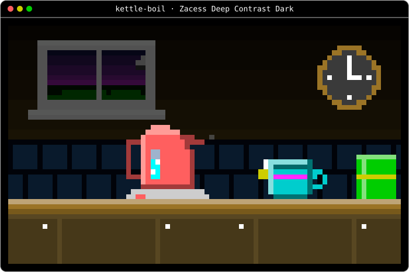

A kitchen counter in solid pixels: a wooden worktop over cupboard doors with seams and knobs, a
tiled splashback and a window with a glazing bar and a sill onto a line of trees and a hedge
under a slowly drifting cloud, evening on a dark theme and daytime on a light one. Beside the
window hangs a shelf of up to four storage jars. Where the shelf would not fit or would be in the
kettle's way a round wall clock hangs instead, its hands still at three o'clock. On the counter
stand a jug kettle on its base, a mug with a painted band and a tea bag's tag hanging over its
side and a tea tin. The lamp on the base comes on and bubbles start to climb the water gauge on
the kettle's side, growing busier as the water heats, until steam begins to curl from the spout
and sway as it rises. Near the boil the lid starts to lift and settle (`RATTLE_PERIOD`) and the
water is at a rolling boil at 12 seconds (`BOIL`). At 16 seconds (`CLICK`) the switch clicks off
and the lamp goes out. The kettle then lifts from its base, moves over the mug and tips, pouring
a stream into it, tips back and goes home to its base with less water in its gauge. The mug is
full of tea and steam rises from it from then on.

- Colours: the wall, the tiles and grout, the view and its cloud, the window frame, the
  cupboards, the jars' glass and contents, the clock's face and the steam are tints of the
  background below the non-text floor; the kettle in red, shaded lit on the left and darker on
  the right, with a gauge of grey glass and bright cyan water; the base in a grey mixed towards
  the text colour with a red lamp, grey when off; the mug in cyan with a magenta band, tea in a
  dark yellow and red mix, a yellow tag and its string in the text colour; the worktop in a dark
  yellow and red mix, which also rims the clock; the clock's hands and the cupboard knobs in the
  text colour; the tin in green with a yellow band; the jar lids in blue, magenta and yellow.
- Light themes: the kitchen by day with a bright sky in the window instead of an evening one;
  the steam, the bubbles, the jars' glints and the clock's face are the background colour and
  the wall pales towards the counter instead of warming.
- Small screens: the window needs 40 columns and room above the splashback, which drops to one
  row of tiles below 22 rows; the shelf and the clock need room beside the window and the tin
  needs 15 rows and room beside the mug; on a narrow screen the kettle and the mug close up as
  one group in the middle; a large screen draws everything bigger.
- Reduced motion: the story takes twice as long, steam rises and sways at half speed with fewer
  puffs, the lid lifts half as often and the cloud drifts at half speed.
- Tests: the lamp is lit and no steam rises at first; steam rises once the water boils; the lamp
  is out and the spout is over the mug's mouth while it pours; the kettle is back on its base, the
  mug full and steaming afterwards; a curl of steam and the lid keep their periods at every motion
  setting; every theme keeps its tints below the floor, its objects apart and the note's words at
  the floor; the shared pixel checks over 24 seconds.

## rocket-launch

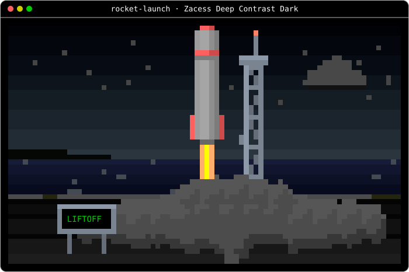

A launch pad on the coast, at dusk on a dark theme and on a clear afternoon on a light one,
painted in solid pixels. The sea runs out behind the pad to a low headland on the left, glints
drifting along it and surf sliding along the beach, with clouds crossing the sky and a few early
stars after dark. A lattice gantry stands beside the pad with a cab, a mast and a steady beacon on
top. A white rocket with a red nose, a red fairing band, a stage line and swept fins rolls in
upright on its tracked platform, the wheels turning, over 14 seconds (`ROLL_IN`) and the gantry's
access arm swings in to it. The board on the apron shows T-10 and ten seconds before ignition it
starts counting down (`COUNT`); six seconds before ignition the arm swings away. At zero the
board holds T-00 and the engine lights (`IGNITE`): a glow swells behind the foot of the rocket
over four seconds, the flame grows under the engine bell down into the trench under the platform
and a cloud of smoke billows out along the ground. At lift-off (`LIFT`) the board reads LIFTOFF
and the rocket climbs, slowly at first and then faster, out of sight in 16 seconds (`CLIMB`),
leaving a trail whose puffs swell and drift with the wind as they age. Once the rocket has gone
the cloud and the trail break up and thin away, the empty platform rolls off and the next rocket
rolls in, one launch every 76 seconds (`CYCLE`). The flame's length wavers once every three
seconds (`FLAME_PERIOD`), never a flicker. The scene opens a second after lift-off.

- Colours: the sky, the stars, the clouds, the headland, the sea and its glints, the beach and its
  surf, the apron and its seams, the smoke and the glow are tints of the background below the
  non-text floor; the rocket's body in a white shaded from its lit left side, its nose, band and
  fins in red, the gantry and the board's frame in grey steel, the platform in grey with darker
  treads, the flame in orange with a yellow core and the beacon in the error colour keep the
  floor. The smoke and the body are white whatever the theme's text colour, so the Yellow on Black
  launch is not yellow. The countdown is in the text colour and LIFTOFF in green on the board's
  plain face.
- Light themes: a clear afternoon instead of dusk, a pale sky over a deeper sea, with no stars; the
  smoke is shaded in pale greys and the flame's core is a pale glare inside a solid red and orange
  edge.
- Small screens: the board needs 50 columns and 14 rows; below 3 rows only the setting is drawn;
  one cloud for every 45 columns, up to six.
- Reduced motion: the launch runs on its own clock at half pace, so the board changes every two
  seconds, the glow swells over eight and the flame wavers half as often; the sea, the surf and
  the clouds drift at half speed. The clock keeps the standard pace on lively, so the count never
  runs faster than a second a number.
- Tests: the board counts down from T-10 through T-05 to LIFTOFF, the rocket never sinks while it
  climbs and the next one rolls in from off the left; the board changes no more than once a second
  and the glow never jumps at any motion setting; the rocket, the gantry, the platform, the beacon
  and the board are drawn and a resize keeps the clock; the imagery stays under the ceiling, the
  shapes keep the solid floor and the sky and sea, sea and beach, rocket and gantry, band and body
  and flame and core stay apart in every theme; the shared pixel checks.

## pit-stop

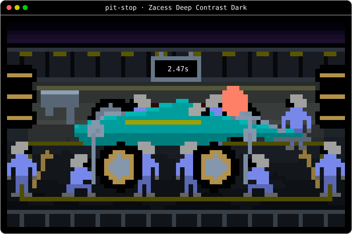

A pit lane seen side on, at night under the lamps on a dark theme and on a bright afternoon on a
light one, painted in solid pixels. The pit building runs along the back with its roof and a row
of lamps under its lip, a panelled wall and closed roller doors either side of the open garage in
the middle, lit from inside with tool cabinets under a strip light and a stack of three tyres
at each side of the doorway. A timing board hangs on two wires over its door. In front, the lane
has a box painted on it in perspective, a dashed line between the working lane and the fast lane
and a pit wall with a lit cap along the front. A race car of no real team, cyan with a yellow
stripe and the driver's helmet showing, slides in along the lane and brakes into its box over
seven seconds (`ARRIVE`). The jack men lift it at both ends (`JACK`), a gunner kneels at each
wheel and the old wheels come off outwards to their carriers while the new ones go on from the
carriers nearer the middle of the car (`SWAP`). The jacks drop, the lollipop swings up from its
red side to its green side (`LIFT`), the board changes to the new stop time and the car pulls away
slowly, then faster (`LEAVE`), the lollipop swinging back down once it is clear. The carriers then
walk the old wheels to the stacks and come back with new ones (`FETCH`) before the next car
arrives, one stop every 30 seconds (`CYCLE`). The board cycles through five stop times between
2.29 and 2.52 seconds.

- Colours: the sky, the building and its lamps, the garage and its cabinets, the lane, the box
  and the pit wall are tints of the background below the non-text floor; the car in cyan with a
  yellow stripe, the crew in blue with helmets in the text colour, the tyre bands in the warning
  colour when fresh and grey when worn, the jacks in the warning colour, the guns, the lollipop's
  pole and its sides in the error colour and green keep the floor. The board's face is the plain
  background so its time keeps the text floor.
- Light themes: a bright afternoon sky instead of a night one, lamps that are almost the
  background colour, a darker roof over a paler wall and the board's time in the theme's darkest
  shade instead of its text colour.
- Small screens: the car and crew come in three sizes drawn at up to three times their pixel size
  and the largest that fits is drawn; below about 78 columns or 15 rows a small car comes in with
  only the gunners and the lollipop, keeps its wheels on and the garage has no tyre stacks; the
  board needs 24 columns and room above the garage door.
- Reduced motion: the car slides, the crew walk and the wheels move at half speed, so each stop
  takes twice as long.
- Tests: the car stops jacked up in its box, the board changes once a stop to the new time, a new
  car comes in and the car has left the screen when the carriers fetch new wheels; the imagery
  stays under the ceiling, the car, crew, rims, fresh bands and both sides of the lollipop keep
  the solid floor and the car and lane, crew and lane, crew and car, fresh and worn tyres, the
  lollipop's two sides and the stuck nut and rim stay apart in every theme; the shared pixel
  checks.

## pcb-bring-up

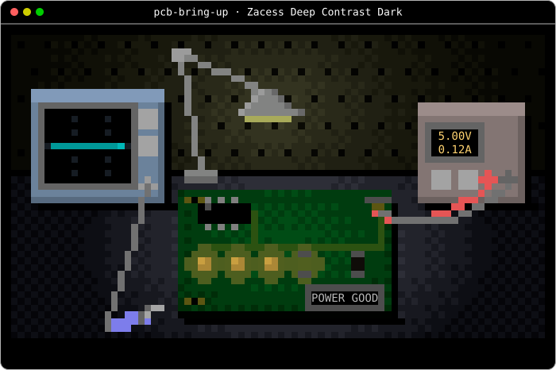

A workbench seen from the front and a little above, drawn in solid pixels: a workshop at night
lit by the lamp on a dark theme and the same bench by day on a light one. A pegboard wall rises
behind and an angled lamp clamped to the back of the bench lights a pool on the mat. An
oscilloscope stands on the left with its probe lying on the mat beside the board, its lead
running back to the scope's input. A bench supply stands on the right, its red and black
leads clipped to a header in the board's top right corner and its readout showing 5.00V and the
current drawn, 0.04 amps for each lit LED. On the board sit a chip, copper traces feeding a row
of LEDs and, on a larger board, a second chip, a capacitor, a resistor by each LED and plated
mounting holes. The supply is on: the amber LEDs light from the left one every 1.4 seconds
(`STEP`), each glowing faintly for half a second (`WARM`) before it is fully lit, then the status
LED at the end of the chain glows a steady green, the POWER GOOD legend beside it and its outline
light up in green and the scope's flat line becomes a clean square wave, with the beam's bright
spot sweeping along the trace. The board holds for 45 seconds (`HOLD`), the lights fade as the
supply is switched off and after four dark seconds the chain lights again, about once a minute.

- Colours: the wall, the mat, the board, the copper, the lamp's pool, the scope's graticule and
  every glow are tints of the background below the non-text floor; the lit LEDs in amber and
  green, the lamp, the scope with its cyan trace, the supply, the probe and its blue grip keep the
  floor, the readout is in the warning colour and the legend in grey, then green, both on faces
  cleared to the background.
- Light themes: the bench by day, a pale wall and mat with the lamp's pool a touch warmer and
  brighter instead of a dark workshop; the chip is solid in the text colour with tinted pins,
  where on a dark theme it is a nearly black tint with solid pins.
- Small screens: the scope, the supply and the probe need 48 columns and 12 rows, below that the
  board fills the bench alone; the lamp needs 8 rows and the pegboard holes 12; the chain has one
  LED for every 7 columns of board, three to eight; the legend needs a board 16 columns wide and
  10 rows.
- Reduced motion: the LEDs light and fade half as often and the scope's beam holds still.
- Tests: the LEDs light in order no faster than `STEP` at every motion setting and power good
  holds for 30 seconds; the status LED, the lit chain, the glow, the probe, the supply, the scope,
  the legend and the readout show and the chain is dark again after the supply switches off; the
  board and the mat, the pegboard, a dark LED and the board, the chain and the status LED and the
  supply and the scope stay apart, the imagery stays under the ceiling and the LEDs, probe, lamp,
  supply and scope keep the solid floor in every theme; the shared pixel checks over 25 seconds.

# Fail scenes

Slow, serious scenes made for a failing build, like the storm above. Each progresses over its
first minute or few and then holds or eases into a gentle loop, so it still looks right after an
hour. None flashes or shakes.

## flood

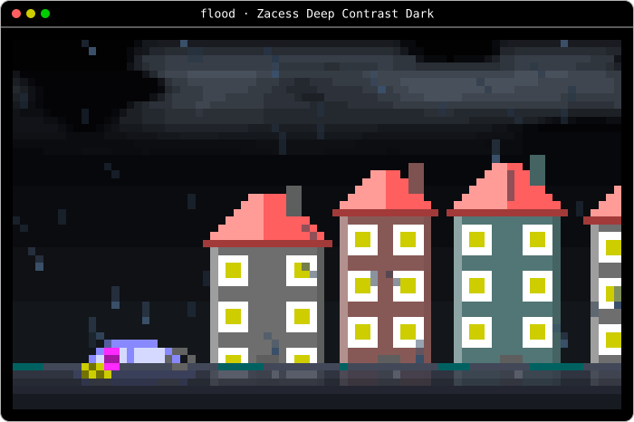

A flooded street in solid pixels. A row of houses stands under an overcast sky with drifting
cloud and a light drizzle, each with walls lit on one side and shaded on the other, a pitched red
roof, a chimney, a door and framed windows on each floor. The street is already awash when the
scene opens, the water up to 3 pixels deep (`START_PIXELS`) around the tyres of a hatchback
parked in a gap of its own between the houses, with its windows clear. Over the first 45 seconds
(`RISE_SECONDS`) the muddy water rises, easing in and slowing as it nears its height: about two
thirds of the way up the lowest house, never more than two fifths of the screen, so the doors and
lower windows go under while the roofs and the sky stay clear. It then holds with a slow swell of
under a pixel every 12 seconds (`SWELL_PERIOD`). Everything under the water is muddied, more so
the deeper it lies. The surface catches the light in crests that drift along it. Debris (a crate,
a barrel, a plank, a ball and a tyre) bobs a pixel up and down as it drifts both ways along the
surface while the car slowly goes under. A resize keeps the water at the height it has reached.

- Colours: the sky, the cloud, the rain, the street and the water are tints of the background
  below the non-text floor, the water a muddy mix of blue and yellow. The houses are solid, their
  walls in the muted colour or the muted colour mixed with yellow, red or cyan, with roofs in a
  shaded red, windows in yellow, frames in the text colour and doors in a dark muted colour. The
  debris is in yellow, magenta, the text colour, bright red and the muted colour. The car is solid
  blue, lit on top and shaded below, with windows a step towards the light and tyres in the door
  colour. With colour off the water line shows as the place where the houses vanish.
- Light themes: the crests on the surface are a paler step of the water rather than a tint of
  bright cyan. The street and the deep water are stronger tints so they still read on a light
  background.
- Small screens: the car is left out under 24 by 10 and drawn smaller under 80 columns; under 40
  columns the houses are narrower too.
- Reduced motion: the water rises, swells and drifts at half speed, the debris bobs half as often
  and the drizzle is halved.
- Tests: the street is awash from the start but no higher than the doors, with the car's body in
  view, then still below the doors after ten seconds; over a simulated hour the surface stays within
  a pixel row of its height for the last minute with the roofs above it and the crests drawn; the
  surface moves at most twice a swell over five swells on lively; a resize keeps the water risen;
  the layers stay apart in every theme, the water and crests below the ceiling and the walls at
  the solid floor; the shared checks and the shared pixel checks.

## listing-ship

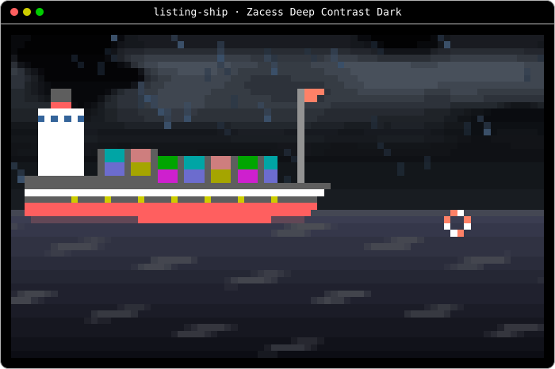

A container ship on a grey sea in solid pixels, under an overcast sky with drifting cloud and
rain. The sea darkens towards the viewer, with highlights drifting across it that fade with
distance from the horizon. The ship has a rounded stern, a raked bow, a red boot topping below a
stripe and a row of portholes on its hull, containers stacked two high along the deck, a bridge
with a row of windows at the stern, a funnel with a red band behind it and a foremast with a flag.
It is drawn by turning each pixel back into the ship's own frame, so every part tips together as
one solid shape. Over the first 50 seconds (`LIST_SECONDS`) it settles bow down to an angle of 8
degrees (`MAX_LIST`) and sinks two pixels, turning about a point a third of the way along its keel
so the stern lifts a little as the bow goes down. Whatever goes below the surface is muddied by
the grey water, so the waterline visibly creeps up past the portholes. It then rolls a degree and
a half either way every 11 seconds (`ROLL_PERIOD`). Once it has been listing for four seconds a
lifebuoy and a crate drift away along the surface, riding its slow swell. On a wide screen the
ship sits left of the middle, so the watch mode's panel leaves it in view.

- Colours: the sky, the cloud, the rain and the sea with its highlights are tints of the
  background below the non-text floor, the sea from the muted colour and blue. The ship is solid:
  its hull a shaded dark muted colour with its lower half in shadow, the boot topping and the
  funnel's band red, the stripe and the bridge in the text colour, portholes in yellow, containers
  in blue, green, yellow, cyan, magenta and bright red, the bridge windows in a dark info colour,
  the mast a lit step of the hull and the flag in the error colour. The lifebuoy is in the error
  colour and the text colour and the crate in shaded yellow.
- Light themes: the highlights on the sea are a paler step of the water rather than a tint of the
  text colour. The far and near sea are tinted more strongly so they still read on a light
  background.
- Small screens: the hull is 46 pixels long at 70 by 16 and above; below that it is 60 percent of
  the width, between 12 and 40 pixels.
- Reduced motion: it lists, rolls and drifts at half speed, the rain is halved and fewer
  highlights cross the sea, also at half speed.
- Tests: the ship starts level, its angle never changes faster than two degrees a second over ten
  simulated minutes and for the next minute it holds within the roll of its final angle with the
  full sink; the flag, hull, bridge and containers are drawn at 80 by 24 and at 40 by 12 and each
  part of the hull is found from its own frame; the layers stay apart in every theme, the sea and
  highlights below the ceiling and the hull, bridge, flag and boot topping at the solid floor; the
  shared checks and the shared pixel checks.

## corrosion

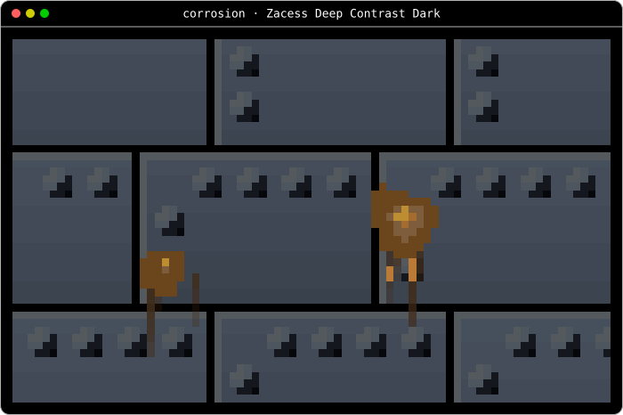

A close view of an old riveted steel wall in solid pixels, lit from the upper left. The plates
are lapped over one another in rows, every other row offset by half a plate, each a touch apart
in tone from its neighbours and shading from its lit top to its lower edge. Each seam is a
shadow line with a lit lip beside it and rows of rivets run under each top seam and beside each
left one, every head lit on its upper left, shaded on its lower right and casting a small
shadow. Rust has taken hold at a few of the rivets, one patch to each band across the wall at
different heights. Each patch creeps outwards over the plates, further below its rivet than above it
and faster along the seams where water lies. Each patch starts as a faint orange film at its
edge, then a dark crusted rim, then crusted scale through which a buried rivet still shows its
lit side and shadow, then a dark blistered core with lit flakes lifting off it. The rust is
already showing when the scene opens; each patch grows to its full size over 150 seconds of
the scene's clock (`GROW_SECONDS`), never more than half the wall, then holds. Rusty stains run
down from inside the lower edge of each patch, some longer and wider than others. Once a
stain has run half its length a drop slides down it at 1.6 pixels a second (`DROP_SPEED`), then
rests for 9 seconds before the next. A resize lays the wall out again at the same age, so the
rust keeps its extent and the wall is never cleaned.

- Colours: the steel from a grey of the muted and info colours, its seams, lips and rivets, the
  orange rust film and the brown stains are tints of the background below the non-text floor.
  The crusted rim, the scale, its flakes and the blistered core are solid browns and oranges from
  the yellow, red and muted colours and the drops are a solid orange. With colour off the rust
  shows as spreading shapes on a blank wall.
- Small screens: the rivets have domed heads four pixels across from 15 rows up and small heads
  below that; the wider stains appear only from 60 columns; the number of patches grows with the
  area, from two to six.
- Reduced motion: the scene's clock runs at half speed, so the rust spreads, the stains run and
  the drops slide at half speed and rest twice as long.
- Tests: rust shows at the start and has grown after 30 seconds; after ten simulated minutes it
  holds for a further minute at under half the wall, with the scale and the core drawn; the edge
  of a patch creeps well under half a pixel a second even on lively; a resize keeps the age of the
  rust; the layers stay apart in every theme, the steel, seams, lips, film, stains and rivet
  shadows below the ceiling and the scale, core and drops at the solid floor; the shared checks
  and the shared pixel checks.

## tangle

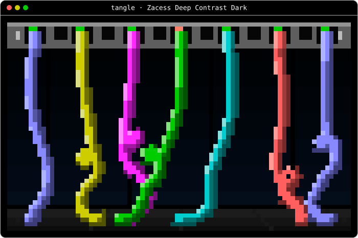

A patch panel across the top of a dim server room wall in solid pixels, lit along its top edge
and shadowed along its lip, with a screw at each end and a row of sockets, the empty ones
between the cables as well. Each cable's plug sits square in its socket with a link light above
it. The wall below has a soft fall of light and tall panel seams and a raised floor of tiles runs
back to it, its joins spreading towards the viewer. Round cables hang from their plugs, each
drawn as a tube lit from the upper left with a dark rim on its shaded side, so where one crosses
another the nearer one reads on top. They are already crossed when the scene opens and over the
next 45 seconds (`TANGLE_SECONDS`) they keep wandering: their lower runs drift across their
neighbours, each cable takes on a slow wave and some swing out into a loop and back up over
themselves. Each cable curves down onto the floor at the bottom and its end trails off to one
side in an easy curve. The snarl sways slowly all the while. The link light on one port in the
middle of the panel has gone red. Every cable stays inside the screen and there are no words on
the scene.

- Colours: the wall with its seams and the floor with its tile joins are tints of the background
  below the non-text floor. The panel is a shaded dark muted colour with darker sockets and
  lighter screws, the link lights are green and the faulty one is in the error colour. The cables
  are blue, yellow, magenta, green, cyan and red, each in four solid tones from shade to a sheen,
  with a rim held under the ceiling. With colour off the snarl keeps its shape.
- Small screens: the cables grow thicker with the height of the screen and show a sheen only
  from about 37 rows; loops form only when the cables hang at least 14 pixel rows; there is at
  most one cable for every seven columns.
- Reduced motion: the cables tangle and sway at half speed.
- Tests: from the first frame some cable has wandered well off its port's straight line and the
  tangle is under half way; within a simulated hour it is fully tangled, the fault light is drawn,
  the scene holds no text and every point of every cable stays on screen; on lively the tangle
  never grows by more than a twentieth of the whole in a second; the layers stay apart in every
  theme, each cable apart from the wall and from its rim, its tones at the solid floor and the
  wall and floor below the ceiling; the shared checks and the shared pixel checks.

## wilt

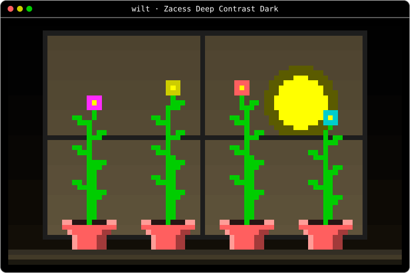

Potted plants in a row on a windowsill in solid pixels, in front of a window full of hard, hot
sun: a pale sky behind two panes, the sun high in the right of the window in a ring of glare and
a frame with glazing bars. The sill has a lit front edge, a top and a shadow under it. Each plant
grows from a red pot 9 pixels wide with a rim a pixel wider than its body, which narrows towards
its foot, a stem two pixels thick in its lower half, leaves on alternate sides and a flower at the
tip with a bright centre. Over the first 50 seconds (`WILT_SECONDS`) the stems bend further and
further, each plant by its own amount, until they arch over and the heads hang over the rims.
The green dries to straw from the tips down and the flowers lose their petals and fade to dry
heads. The leaves dry, hang and let go one by one, drifting down to lie on the sill, while the
soil in each pot cracks open. The drooped stems then sway slowly every 9 seconds
(`SWAY_PERIOD`). Each stem is traced in half pixel steps from its continuous heading, so a bent
stem never skips a pixel. A resize keeps the plants as wilted as they were and lays the fallen
leaves straight back on the new sill.

- Colours: the wall, the window's sky and frame, the glare, the sill and the soil are tints of the
  background below the non-text floor, the sky and sill from a warm mix of the warning and text
  colours. The pots are a shaded red, the stems and leaves green drying to a solid straw, which
  also marks the cracks, the flowers magenta, yellow, red and cyan with bright yellow centres and
  the dry heads a dark muted colour. With colour off the drooping shapes still read.
- Light themes: the sun is a white glare in the background colour inside a warm glow of the
  warning colour, never a dark disc. The sky pales towards the sill.
- Small screens: the window and its sun need room for a window at least 10 columns wide and 6
  pixel rows tall; plants sit 10 columns apart under 40 columns and 16 apart above.
- Reduced motion: the plants wilt, sway and drop their leaves at half speed.
- Tests: fresh plants show their flowers and green stems; within a simulated hour every tip ends
  more than four pixels below where it started, every leaf lands on the sill and stays near the
  screen, the soil cracks and the heads are dry, with every stem dried; a quarter of a sway is
  over a third of a second; the layers stay apart in every theme, the stems, pots and dry heads at
  the solid floor and the wall, sky, glare and soil below the ceiling; the shared checks and the
  shared pixel checks.

## fog

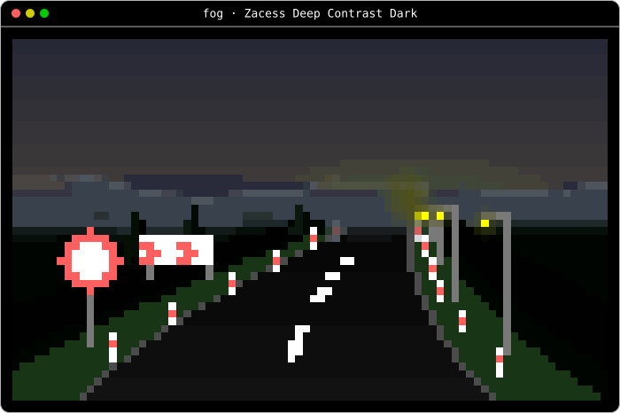

A country road at dusk in solid pixels, seen from the road itself as it runs away from the viewer
and bends off to the right. Grass verges and hedges line both sides, with conifers out in the
fields and a far ridge under a dusk sky whose last light lies low over the bend. The road has
edge lines and a dashed centre line. Lamp posts stand along the right verge, each with an arm
reaching out over the road to its lamp, spaced evenly along the road so they bunch with
distance. Marker posts with red reflectors run along both edges, a round speed limit sign with a
red ring stands on the left near the viewer and a chevron board further on points the way the
road turns. There are no words or warning signs on the scene.

A bank of fog lies far off down the road and rolls towards the viewer over the first 50 seconds
(`ROLL_SECONDS`), its front billowing as it drifts at 1.2 columns a second (`DRIFT`) over
billows 14 columns across. It stands as a wall taller than the lamps, so as it comes nearer it
rises up the screen and swallows the ridge and the far lamps first, then the bend and its board,
until only the nearest stretch of road is clear. Thin wisps run ahead of it over the road and the
far distance stays hazy. Inside the bank its crest and rolling billows catch the last light, so it
reads as a moving body of fog rather than a flat wash. A post or sign the fog has begun to take
drops back to faint imagery at once, so it fades as a ghost rather than lingering half solid,
while each lamp it has taken still glows through it, dimmer and wider the deeper in it lies. A
resize keeps the fog as far in as it has come.

- Colours: the sky, the glow of the last light, the ridge, the fields, the verges, the hedges,
  the conifers, the road, its edge lines and far dashes, the fog and the lamps' halo are tints of
  the background below the non-text floor, the sky from a dusk mix of blue and magenta warming to
  the warning colour and red. The posts are a dark muted colour, the lamps bright yellow, the
  reflectors and the speed sign's ring red and the near dashes, the marker posts, the sign's face
  and the chevron board in the text colour, the board's chevrons red. With colour off the scene
  empties as the fog thickens.
- Light themes: early evening, with a pale blue sky warming at the horizon and the fog a white
  that pales everything it touches. The lamps are yellow, the edge lines, dashes, marker posts and
  the sign's face are in the background colour, the 30 on the sign is in the text colour and the
  chevron board's arrowheads are in the background colour on the text colour.
- Small screens: the 30 on the speed sign appears only when the sign is at least 5 pixels across
  its radius, from 33 rows; on tall screens the lamp posts are two pixels thick and the nearer
  lamp heads two pixels wide; the chevron board carries one to four arrowheads by its width.
- Reduced motion: the fog rolls in and drifts at half speed.
- Tests: the road starts clear with at least three lamp pixels, the speed sign's ring and the
  chevrons drawn and no text on the scene; while it rolls in the hidden share never jumps by more
  than a hundredth of the screen between frames; after a simulated hour the fog hides over two
  fifths of the screen and at least a fifth more than at the start and fewer lamp pixels show;
  the drift is slow against the width of a billow; the layers stay apart in every theme, the
  imagery below the ceiling and the posts, lamps, reflectors and ring at the solid floor; the
  shared checks and the shared pixel checks.

## broken-bridge

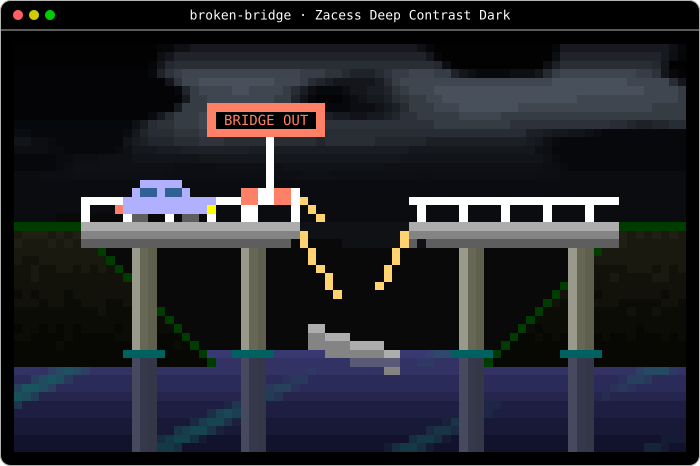

A concrete bridge on stone piers over a river in solid pixels, its middle span gone, under an
overcast sky with drifting cloud and far hills. Grass-topped banks slope down to the water. The
deck and its railing, with a post every five columns, stop either side of a gap about a sixth of
the screen wide, the broken ends jagged and crumbling from below, with bent girders hanging from
both. The fallen span lies tilted in the river, the water running over its low end. The
water muddies the foot of each pier. On the road before the gap a striped barrier stands under a
board on a post, framed in the error colour with `BRIDGE OUT` written across it on a wide enough
screen. A car with a lit headlight and a tail light waits behind it. The river drifts downstream
from left to right with highlights on it. Every four seconds (`FRAGMENT_PERIOD`) a fragment drops
from one of the broken ends, falling faster as it goes. It splashes, first as a small burst and
then as two drops either side, over 0.7 seconds (`SPLASH_LENGTH`).

- Colours: the sky, the cloud, the hills, the banks and their grass and the river are tints of the
  background below the non-text floor. The deck is a shaded muted concrete, the railing the text
  colour, the piers a shaded stone colour, the girders the warning colour and the barrier striped
  in the error colour and the text colour. The board's frame and `BRIDGE OUT` are in the error
  colour on the plain background and the car bright blue with dark windows and wheels, a headlight
  in bright yellow and a tail light in the error colour. With colour off the gap in the deck still
  shows.
- Light themes: the highlights on the river and the splashes are a paler step of the water rather
  than a tint of bright cyan. The hills, banks and deep water are tinted more strongly so they
  still read on a light background.
- Small screens: the barrier needs about 3 rows above the deck and room beyond the bank, the car
  40 columns and the board with its words 60 columns and 8 rows above the deck.
- Reduced motion: the river and clouds move at half speed, fragments fall half as often and at
  half speed and each splash lasts twice as long.
- Tests: at 100 by 30 the deck stops either side of a gap with no deck in it and the girders, the
  barrier, the car, its headlight and `BRIDGE OUT` are drawn, while a deck is still drawn at 20 by
  8; no motion setting makes fragments fall more often than `FRAGMENT_PERIOD`; on lively no more
  than two fragments are in the air at once and they splash; half a splash is over a third of a
  second; the layers stay apart in every theme, the river, banks and hills below the ceiling and
  the deck, piers, girders and car at the solid floor; the shared checks and the shared pixel
  checks.

## leak

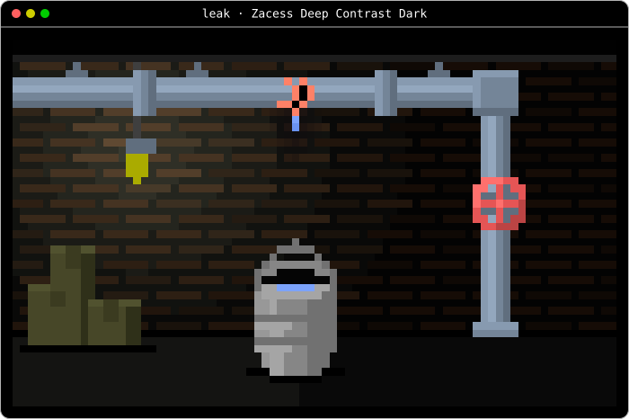

A brick basement in solid pixels, lit by one bare bulb hanging on its flex from the ceiling
slab. The bricks are laid in courses with staggered joints, a few of them a shade apart. The
pool of light falls across them brick by brick, brightest beside the bulb and dim in the corners.
A concrete floor with soft patches catches the light and a stack of three taped cardboard boxes
stands on it to the left. A metal pipe runs under the ceiling on brackets, with collars at its
joints, turns down the right-hand wall at a heavy elbow and passes a shut-off valve with a red
hand wheel on its way into the floor. A little left of the middle the pipe has split open, a
jagged dark crack with rust bleeding round it. A damp stain creeps down the bricks below it,
each column trickling its own way, over 90 seconds (`DAMP_SECONDS`).

A bead of water swells under the crack over 1.2 seconds (`DRIP_PERIOD`), lets go and falls,
gathering speed, into a metal pail on the floor. The pail is a tapered cylinder lit from the
left, with two pressed bands round it and a wire handle resting back over its far rim. It is
already half full when the scene opens and fills drip by drip, each drip sending a ring spreading
on its water, until it brims over within about half a minute: water sheets over the near lip and
runs down its sides in two thin streams with glints running down them. From then on each drip
spreads a puddle across the floor, a flat oval with a lobed edge and a streak of the bulb's light
in it, until it reaches its widest about a minute later and holds there. A resize keeps the water
in the pail and the puddle.

- Colours: the bricks, the mortar, the damp, the ceiling, the floor, the boxes, the inside of the
  pail and the wet floor under the puddle are tints of the background below the non-text floor,
  the bricks from red, yellow and the muted colour warmed by the bulb. The pipe is a solid metal
  grey of the muted and info colours in four tones, the crack dark, the rust round it in the error
  colour, the valve a shaded red, the bulb a solid yellow, the pail a shaded light grey and the
  water a solid blue with a lighter tone for its highlights. With colour off the split pipe and the
  brimming pail still read.
- Light themes: the basement is a pale wall that darkens into the corners rather than a dark room
  lit up by the bulb, so the pool of light still reads. The crack is the theme's darkest shade
  rather than the background.
- Small screens: the bulb needs 30 columns and 10 rows and room above the floor, otherwise the room
  is lit evenly from above; the boxes need 56 columns and 14 rows; the valve needs 8 pixel rows of
  wall under the pipe; the bead takes its fuller pear shape from 20 rows.
- Reduced motion: drips come half as often and fall at half speed, so the pail fills and the puddle
  spreads twice as slowly; the rings spread and the overflow runs at half speed.
- Tests: no motion setting makes the drips quicker than `DRIP_PERIOD`; after ten seconds the pail
  is fuller than at the start but not full, with no puddle; ten minutes later it is full with
  the puddle at its widest and the crack, the rust, the water, the puddle, the valve and the bulb
  drawn; a resize keeps the water; the layers stay apart in every theme, the imagery below the
  ceiling and the pipe, pail, rust, water, bulb and valve at the solid floor; the shared checks and
  the shared pixel checks.

## blackout

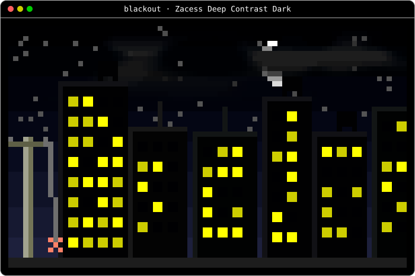

A city skyline at night in solid pixels beside a wooden power pole whose line has snapped.
Buildings of different widths and heights stand in a row along the street, each lit along its top
and left edges, some with a water tank on legs or an aerial on the roof, each with a grid of
windows. About two thirds of the windows start lit in two shades and they go dark one at a time
over about a minute and a half (`DARKEN_SECONDS`), in a random order, never two closer than a
quarter of a second (`MIN_WINDOW_GAP`). Five seconds after some windows go dark a candle is lit
in them, a small flame in a soft glow. A few windows stay lit on their own power, so the city
ends quiet but not empty. The pole's line sags from the crossbar towards the buildings and hangs
where it broke, the break a fixed cross of sparks that never moves. Stars, a crescent moon behind
the cloud and slow drifting cloud sit above. Once dark the city stays dark; only the cloud moves.
A resize lays the city out again with the same share of its windows dark and any candles already
lit.

- Colours: the sky, the cloud, the stars, the buildings, the dark windows, the street and the
  candles' glow are tints of the background below the non-text floor. The lit windows are yellow
  and bright yellow, the candles the warning colour, the moon the text colour, the pole a shaded
  wood colour, the line a dark muted colour and the break the error colour. With colour off the
  lights going out are seen as shapes going away.
- Light themes: the same street at dusk, under a fading sky with no stars and a pale moon held
  below the non-text floor. The lit windows are a warm gold, as bright as a lit window can be while
  it stays solid, so the lights going out read the same way.
- Small screens: the pole needs 40 columns and 10 rows and the moon 30 columns and 12 rows.
- Reduced motion: the windows go dark at half the rate and the clouds drift at half speed.
- Tests: on lively at 100 by 30 more than 20 windows start lit, no more than one goes dark in a
  frame and within ten simulated minutes only the windows on their own power are still lit, with
  the break and the moon drawn; no window changes more than twice in a minute, a candle coming at
  least a second after the window goes dark; a resize keeps how dark the city is; the layers stay
  apart in every theme, the imagery below the ceiling, the lit windows, candles, break and pole at
  the solid floor and the moon solid by night and a pale tint apart from the sky at dusk; the
  shared checks and the shared pixel checks.

## traffic-jam

A traffic jam seen side on in solid pixels. A road with a pavement and kerbs runs along the
bottom of the screen, in two lanes split by a dashed line when there is room. Behind it a verge
with a line of round trees, lit on their upper halves, stands in front of a town skyline of
flat-roofed blocks in two rows, under a dusk sky glowing low over the town with clouds drifting
across. Sedans, hatchbacks and vans in several colours stand bumper to bumper in each lane, each
with glass, tyres with hubs, a headlight and a steady red brake light whose glow lies on the road
behind it. The jam is already there when the scene opens, one car short in each lane. The
last arrivals roll in from the left in the first seconds and ease to a stop; after that nothing
moves but the exhaust and the clouds. Past the front of the queue a cone with a white band stands
in each lane and a signal on the far pavement is stuck on red: its top lamp is a filled red disc
with a soft halo while the two below are dull, so it reads without colour. On a large enough
screen a `ROAD CLOSED` board, a plain panel between red and white stripes on two legs, stands on
the verge beside it. Each stopped car gives a small exhaust puff every three seconds
(`PUFF_PERIOD`) that drifts up and back, swelling and thinning over 2.8 seconds. A resize keeps
the cars already queued, as many as still fit.

- Colours: the sky, the cloud, the skyline and its lit windows, the verge, the trees, the road,
  the pavement, the kerbs, the lane markings, the glass, the unlit lamps, the halo, the brake
  glow and the puffs are tints of the background below the non-text floor. The cars are shaded
  blue, magenta, cyan, green and yellow with a headlight in bright yellow. The brake lights, the
  lit lamp and `ROAD CLOSED` are in the error colour, the cones in the warning colour, the board's
  stripes red and white and the signal's housing a shaded dark muted colour on a dark muted pole.
  With colour off the queue keeps its outline and the lit lamp is the only filled one.
- Light themes: a clear day instead of dusk, with a pale sky, a pale blue grey skyline with no
  lit windows, greener trees and verge and solid dark tyres.
- Small screens: two lanes from about 17 rows, one below; the larger car shapes from 22 rows and
  60 columns and drawn at double size from 85 rows by 260 columns; the skyline and the trees need
  10 pixel rows of sky; the signal stands on its pole when there is room above the road and is a
  single red lamp on a stub otherwise; the board needs the larger cars, 50 columns and 13 pixel
  rows of sky.
- Reduced motion: the last cars roll in at half speed, puffs come half as often and the puffs and
  clouds drift at half speed.
- Tests: on lively at 100 by 30, after five simulated minutes there are two lanes of at least
  three cars, every car at rest at its place with none past the stop and the back of each queue
  near the left edge, with `ROAD CLOSED`, the brake lights, the unlit lamps, a cone, the glass and
  the hubs drawn; at 120 by 34 each lane already holds at least two cars at the start; no motion
  setting makes the puffs quicker than `PUFF_PERIOD` and every sprite is rectangular; the layers
  stay apart in every theme, the imagery below the ceiling and the brake light, cone, housing and
  headlight at the solid floor; the shared checks and the shared pixel checks.

## erosion

A layered chalk cliff above the sea crumbling slowly, in solid pixels, under an overcast sky with
drifting cloud. Grass runs along the clifftop above banded rock lit along its face and shadowed
just behind it, while the waves roll in towards the cliff and break white at its foot. Every 2.2
seconds (`CRUMBLE_PERIOD`) a piece two rows tall breaks from the face and tumbles out into the sea
as a stone that splashes, first as a small burst and then as two drops either side, over 0.7
seconds (`SPLASH_LENGTH`). The top and the bottom rows wear fastest. No row may stand more than
two pixels out from its neighbours, so the face stays rough but continuous as it creeps back. A
fence along the top stood right up to the edge: as the ground goes, the posts past the edge are
left hanging down the face. A board on a post with `KEEP BACK` written across it and a cottage
stand well back from the edge. After a few minutes, once the face has worn back about a seventh
of the screen's width, it reaches harder rock and stops wearing, with a pebble falling every
seven seconds. A resize keeps how far each row has worn.

- Colours: the sky, the cloud, the sea and its surf, the rock, its lit face and shadow and the
  grass are tints of the background below the non-text floor, the rock from a chalk mix of the
  muted colour and yellow and the sea from cyan to blue. The standing fence posts are a solid
  tan, the hanging fence the warning colour, the board's frame and `KEEP BACK` the error colour on
  the plain background and the stones a solid muted colour. The cottage has a red roof, walls in
  the text colour, windows in bright blue and a door in a dark muted colour. With colour off the
  fence is seen hanging over the edge.
- Small screens: the cottage needs 50 columns and about 5 rows above the clifftop; the board
  needs room behind the fence and 7 rows above the clifftop; the fence has two to six posts by the
  width.
- Reduced motion: pieces break away half as often and fall, splash and drift at half speed, with
  a pebble every 14 seconds once the cliff holds.
- Tests: at 100 by 30 the edge has worn back on at least three rows within a minute; after an
  hour it has stopped without wearing past its limit, the fence hangs down the face and the board
  with `KEEP BACK` is drawn; no motion setting breaks pieces away quicker than `CRUMBLE_PERIOD`
  and half a splash is over a third of a second; a resize keeps the worn edge; the layers stay
  apart in every theme, the sea, surf, rock and face below the ceiling and the posts, the hanging
  fence and the stones at the solid floor; the shared checks and the shared pixel checks.

## drought

A parched plain in solid pixels, seen from just above the ground. A hot, hazy sky runs down to low
hills and a band of haze along the horizon, with a heavy sun to the left inside two rings of glare.
It sits still and never shimmers. The ground is cracked into plates of dry mud laid out in
perspective, large close by and small towards the horizon, each its own shade and paler further off.
A plate's edge over a crack catches the light as a lip and the edge on the far side curls into
shade. Beyond a certain distance the plates give way to a smooth far plain that fades into the haze.
The scene opens with most of the cracks already there (`FIRST_CRACKS`) and the rest open one whole
edge at a time at the pace of a full spread over a minute (`CRACK_SECONDS`), so the last ones are
open about eleven seconds in. A dry riverbed winds away into the distance, a channel of pale sand
with a few stones between a shaded left bank and a lit right one. Its last puddle shows the bright
sky in its far half and deep water in its near half and shrinks one step every six seconds
(`PUDDLE_SHRINK`) through eight steps until only a damp stain is left. A dead tree stands bare on
the right, its limbs forking from a seed of its own so a resize keeps the same tree, its roots
flaring into the ground and a long shadow thrown away from the sun across the cracks. Dust drifts
past and a single bird glides across the sky above the sun's glare with its wings held still. Once
dry the scene stays dry.

- Colours: the sky, the haze, the hills, the glare, the earth and its plates, the lips and the
  shaded edges, the riverbed and its banks, the stones, the puddle, the damp stain, the tree's
  shadow and the dust are tints of the background below the non-text floor. The tree is solid, a mix
  of the muted colour and the soil. The bird is in the text colour. On a dark theme the sun is
  bright yellow and solid while the cracks are a dark tint.
- Light themes: the sky is mixed towards the info colour instead of blue, the sun is a pale, white
  hot disc in a glare of warning tints and the cracks are solid, a mix of the soil and the text
  colour pushed to the solid contrast, so with colour off the bare tree still stands over the
  cracked ground.
- Small screens: the haze line needs 9 rows, the tree 24 columns and 10 rows, the sun 16 columns and
  12 rows and the bird 14 rows.
- Reduced motion: the cracks open and the puddle dries at half the rate and the dust and the bird
  move at half speed.
- Tests: on a light theme the puddle shows early; after an hour more cracks show than at the start,
  the cracks are complete, the puddle is gone and the damp stain and the tree are drawn, with the
  sun drawn on the default dark theme; the nearest row of ground crosses fewer than half as many
  plates as a row a quarter of the way down and the tree has at least 20 limbs; at every motion
  setting the puddle shrinks one step at a time, never twice within `PUDDLE_SHRINK`; the layers stay
  apart in every theme, the tints stay below the non-text floor and the tree and the bird are solid,
  with the sun solid on dark themes and the cracks solid on light ones; the shared pixel checks.

## volcano

A volcano at dusk in solid pixels. A tall cone stands in the middle, steep under the crater and
spreading out towards the foot, its flanks cut by ridges and gullies that fan out from the summit,
each ridge with a lit left face. Two lower ranges stand behind it, the further one paler. A plain
lies in front. The crater is a notch in the summit with the fire showing over its far lip, its light
thrown up into the sky above. A plume of ash billows up from it, widening as it rises, leaning away
on the wind higher up and warmed from below by the fire, with a few glowing embers lifting through
it on slow paths of their own. Lava breaks over the rim in three flows, one after another
(`FLOW_DELAYS`), each taking 70 seconds to creep from the crater to the foot (`LAVA_SECONDS`) and
widening as it goes. Each flow has molten rock in the middle with glints running down it, a cooling
crust at its edges, a front glowing hottest and warm light thrown on the rock either side. Where a
flow reaches the foot it spreads into a pool on the plain over 30 seconds (`POOL_SECONDS`), with a
crusted rim, a swirl of hotter rock and a glow on the ground round it. The scene opens 28 seconds
into the eruption (`HEAD_START`), so the first flow is already part way down. Once every pool has
spread the lava holds, with the ash and the glints still moving.

- Colours: the sky, the far ranges, the cone, the plain, the ash and the fire's warm light are tints
  of the background below the non-text floor. The lava and its hot glints are pushed to the text
  floor, the front and the crater's fire are solid and the crust is solid. The embers are in the hot
  lava colour. With colour off the lava still shows creeping down the mountain.
- Light themes: the dusk is a pale, hazy evening with the cone and the ash darker than the sky
  instead of lit out of a deep sky. The crust is a darker brown beyond the lava rather than a
  lighter one.
- Small screens: the plume needs 3 rows; the embers need 40 columns and 14 rows and number one for
  every 30 columns, from two to six.
- Reduced motion: the lava creeps, the pools spread and the ash, the glints and the embers move at
  half speed.
- Tests: the first flow's front never creeps more than one pixel row of the flank in a second; after
  150 seconds more than twice as much molten rock shows as at the start and every flow has reached
  the foot with its pool fully spread; the sky, the two flanks, the ash and the sky, the far range
  and the sky, the cone and the far range and the lava and its crust stay apart in every theme; the
  ash and the glints move under 2.5 pixels a second at every motion setting; the shared pixel checks
  and the palette check.

## rockslide

A rockslide in solid pixels. A steep mountainside of layered rock fills the left half, a high crag
falling in a broken face that eases out into a scree fan at the foot, its layers dipping gently to
the left with a ledge of shadow under each one and a few shrubs clinging to them. High on the face a
fresh pale scar with a ragged edge shows where the rock broke away. Far hills lie along the valley
under a sky with drifting clouds and a two-lane road with a dashed middle line and kerbs runs along
the valley floor above a grass verge. Boulders break loose under the scar, one every 2.4 seconds at
the standard pace (`ROCK_PERIOD`). Each is a lumpy, faceted stone lit from the upper left with a
dark rim, the larger ones with a crack across them. They gather speed down the face, strike it and
bounce off in heavy hops, turning as they go and throwing up a puff of dust where they strike hard.
At the foot each one lands on the road and rolls on to its place in a heap of up to three rows
across the near lane, raising dust as it settles. The scene opens with four boulders already in the
heap (`START_PILE`). A striped red and white barrier on two posts stands in the road beyond the
heap. Once every place in the heap is filled only a pebble comes down every six seconds
(`PEBBLE_PERIOD`), coming to a stop against the heap and lost among its stones.

- Colours: the sky, the clouds, the hills, the mountainside and its ledges, the scar, the shrubs,
  the road, its kerbs and line, the verge and the dust are tints of the background below the
  non-text floor. The boulders are solid tones of a grey stone, their bodies at the text floor. The
  barrier's stripes are solid red and a light tone of the text colour on solid posts. With colour
  off the falling rocks and the blocked road still read.
- Light themes: the mountainside is a darker face against a pale day sky, with its lit faces nearest
  the background, instead of a face lit out of an evening sky. The road's dashed line is in the
  background colour.
- Small screens: rocks only break loose with 4 rows or more; the clouds need 10 rows, one for every
  50 columns up to four; the barrier needs 50 columns, 12 rows and room beyond the heap; the heap's
  bottom row holds between three and nine boulders as the width allows. A resize drops the rocks in
  flight and rebuilds the heap for the new size with the same number of boulders in it.
- Reduced motion: the gap between boulders is doubled and the fall runs at half speed, so they come
  a quarter as often; at most three puffs of dust show at once instead of eight and they settle at
  half the rate; the clouds drift at half speed.
- Tests: at 80 by 24 the heap has at least six places; over five minutes no rock falls through the
  road, every place is filled and resting and no more than three loose rocks remain; a resize keeps
  the heap; the sky, the lit and deep rock, the mountainside and the sky, the road and the verge,
  the scar and the rock, a boulder's body and its highlight and the barrier's stripes stay apart in
  every theme; the shared pixel checks and the palette check.

## dust-storm

A dust storm in solid pixels. Open desert lies under a low sun on the left in a soft glow, with
three flat topped mesas on the horizon, their sunlit left faces lighter than their shaded right
ones. A flat plain runs out behind two ranges of dunes, each with a long gentle rise to its crest
and a short steep lee face in shade. A line of telegraph poles runs away to the right, each smaller
than the last, their wires sagging between the cross arms. A wire fence runs along the near ground.
A towering wall of dust rolls in from the right over a minute (`STORM_SECONDS`), its front already
in sight when the scene opens (`STORM_START`). Its leading face leans back and is stacked with round
billows lit on their upper left by the sun, more billows running along its top, each swelling and
shrinking slowly. A low haze of kicked up sand runs ahead of its foot. The dust hides far things
first and near things last, swallowing the far poles, the mesas, the dunes and finally the sun while
grains of sand stream past inside it, more of them as the storm builds. Once the wall has passed the
dust holds at a settled thickness (`SETTLED`), its body still churning slowly, with the near pole
and the fence standing clear in front of it.

- Colours: the sky, the glow, the mesas, the plain, the dunes, the far poles, the wall of dust and
  the streaming sand are tints of the background below the non-text floor. The near pole and the
  fence are in the muted colour, so they keep their outline however thick the dust and with colour
  off. On a dark theme the sun is solid bright yellow.
- Light themes: the sky is a pale hot blue fading to cream instead of a deep dusk warming to the
  horizon, the sun is a pale disc among the tints rather than a solid one and the wall is a deep
  ochre with paler rims instead of lit lighter than the sky.
- Small screens: the fence needs 5 rows, its posts 9 columns apart at 80 columns or more and 7 apart
  below, with taller posts and a second wire at 15 rows; the sun needs 24 columns and 8 rows and the
  near pole 30 columns and 8 rows.
- Reduced motion: the wall rolls in, its billows stir, its body churns and the sand streams past at
  half speed.
- Tests: the wall's front is in sight in the right half from the start; no second thickens the dust
  over the screen by a twentieth or more; by 90 seconds the dust is much thicker than at the start,
  the wall has passed and over the last ten seconds the dust stays within a narrow band near
  `SETTLED`; there are at least four poles, each further right and smaller than the last; reduced
  motion rolls in at half the rate; the sky, each dune's two sides, the lit and deep dust, the dust
  and the low sky and the mesas and the low sky stay apart in every theme; the shared pixel checks
  and the palette check.

## thin-ice

Thin ice in solid pixels. A frozen lake lies under a moonlit winter sky, lighter towards the
horizon, with the moon over the far shore on the right. Snowy hills stand behind two rows of pines
on the far shore, a dense pale row behind and a darker row in front with snow along the top of each
tier. Snow lies along the shore. The ice is stronger nearer the viewer, with soft drifts of snow
lying on it, the shore's shadow along its far edge and the moon's light lying on it in a widening
path below the moon. On the near bank a drift of snow rises on the left with a few bulrushes
standing out of it, each a thin stalk with a dark seed head and a leaf. Light snow falls throughout.
From one weak point in the middle of the ice nine main cracks run out in a rough star, wandering as
they go and throwing off branches further out, flatter across the ice than along it since it is seen
at a low angle. A ring of fracture bowing outwards joins them a little way out. The scene opens with
the first cracks already showing (`CRACK_START`) and they reach their full spread in a minute
(`CRACK_SECONDS`). Once the cracks are a fifth of the way out a ragged hole of dark water opens
round the weak point over 40 seconds (`HOLE_SECONDS`), deeper in the middle and in shadow on its far
side, with the near lip of broken ice catching the light. The fracture is laid out from its own
seed, so a resize redraws the same pattern and keeps the spread reached so far. Once the cracks have
spread they hold, with only the snow still falling.

- Colours: the sky, the hills, the pines and their snow, the bank, the ice, the drifts, the
  moonlight, the shadow, the water, the hole's lip and the edges of the flakes are tints of the
  background below the non-text floor. On a dark theme the cracks and the snow are in the text
  colour and the moon in the theme's bright colour. The reeds are a solid straw colour and their
  seed heads a solid rusty brown, so the fracture and the reeds keep their outline with colour off.
- Light themes: a pale winter day, a clear blue overhead fading to white, with a pale low sun in the
  moon's place and its light on the ice; the cracks are in blue, the water is a darker tint than the
  ice and each white flake has a soft cool grey edge below it so it shows against the pale sky.
- Small screens: the moon and its light on the ice need 30 columns and 14 rows; the drift and the
  reeds need 30 columns and 8 rows.
- Reduced motion: the cracks spread and the hole opens at half the rate and the snow falls at half
  speed.
- Tests: the weak point shows from the start; no frame adds more than 24 pixels of crack and none
  are lost; after 90 seconds every crack shows and the hole is fully open; a resize down to one cell
  and back keeps the spread; reduced motion spreads more slowly; the sky, the pines and the hills,
  the far and near pines, the far and near ice, the ice and the bank, the water and the ice, the
  deep water and the ice and a flake and its edge stay apart in every theme; the shared pixel checks
  and the palette check.

## short-circuit

A circuit board seen from above, drawn in solid pixels. A square processor with pins on all four
sides, a printed pin one dot and printed corner marks round its footprint sits on the left, with a
smaller chip notched at its pin one end above and to the right and a bus of traces running between
them. A crystal sits on two of the processor's top pins, a column of banded resistors joins a rail
down to a capacitor, a few small parts sit by the processor and two capacitors seen from above show
a printed ring, a polarity stripe and the cross scored in their tops. The processor's lower pins run
down to gold edge fingers, the corners carry mounting holes and the copper traces are routed with 45
degree bends through two vias. One trace, from the processor's lowest right pin to the left
capacitor, has burnt through. The scene opens with the damage already part way (`FAULT_START`) and
it spreads over 50 seconds (`FAULT_SECONDS`): the copper blackens back along the trace either side
of the break, whose ends show in the error colour round a glowing ember. A ragged scorch mark
spreads round it, darkest in the middle. A soft glow round the break swells and fades once every
five seconds (`GLOW_PERIOD`). A burst of two or three sparks leaps up and out from the break and
falls back, no sooner than 1.6 seconds after the last (`SPARK_PERIOD`), each spark a pixel with a
short tail that cools to an ember before it goes, 0.9 seconds after it left. A thin curl of see
through smoke rises from the break. Once the damage has spread it holds.

- Colours: the board, the traces, the copper, the scorch, the burnt copper, the glow and the smoke
  are tints of the background below the non-text floor. The break's ends are in the error colour and
  the ember a strong orange. On a dark theme the chips are nearly black tints with lighter edges,
  the pins are in the muted colour, the printing is in the text colour and the sparks are bright
  yellow, so the board keeps its outline with colour off.
- Light themes: the chips are the darkest solid with a solid edge while the pins and the printing
  become pale tints. The sparks are a strong tone of the warning colour instead of bright yellow.
- Small screens: the parts need 30 columns and 8 rows; below that a single burnt trace crosses the
  board. The crystal only shows when there is room above the processor.
- Reduced motion: bursts come half as often with two sparks each and the sparks move half as fast;
  the glow swells half as fast; the damage spreads and the smoke rises at half the rate.
- Tests: at every motion setting over two minutes there are at least 15 bursts, never more than
  eight sparks at once and the bursts are at least 1.4 seconds apart, 2.5 under reduced motion; the
  damage starts above nothing and below half, is complete after 90 seconds and leaves the break's
  ends in the error colour and at least 20 pixels of burnt copper with the processor drawn; the
  board and the traces, the copper, the chips and the scorch, the traces and the pads, a chip and
  its edge, a capacitor and its stripe and the burnt trace and a good one stay apart in every theme;
  the shared pixel checks and the palette check.

## overgrown

An overgrown garden in solid pixels. A brick wall in courses offset by half a brick runs across
under the sky, with an iron gate of bars and three rails between two capped stone posts and the
garden beyond, sky over a far lawn, showing through the bars. A paved path of slabs that grow bigger
towards the viewer runs up to the gate through a lawn with fixed tufts of grass. Vines climb both
posts first, then every bar of the gate and the wall either side of it, wandering as they go,
leafing out either side and now and then flowering. Weeds of two or three short stems push up
between the paving slabs, taller nearer the viewer, some of them flowering, until the path is lost
and the gate is half hidden. The scene opens with the growth already begun (`GROW_START`) and the
growth takes a minute and a half (`GROW_SECONDS`), then holds, the tips of the vines and weeds
stirring a pixel either way once every nine seconds (`SWAY_PERIOD`). The growth is laid out from its
own seed, so a resize keeps the same garden and the growth reached so far.

- Colours: the sky, the bricks, the mortar, the lawn, its grass, the paving and its joints are tints
  of the background below the non-text floor; the posts in the muted colour, the gate in grey, the
  stems in green, the leaves in bright green and the flowers in yellow, so the overgrowth reads as
  shapes and keeps its outline with colour off.
- Small screens: the growth needs 12 columns and 5 rows.
- Reduced motion: the growth takes twice as long and the tips stir half as often.
- Tests: some growth shows from the start; it never adds more than 20 pixels in a frame, all of it
  shows after two minutes, over three times as much as at the start; a resize down to one cell and
  back keeps it; at every motion setting a tip never moves twice within a second; the sky, the
  bricks and the mortar, the lawn and the path, the slabs and their joints and the lawn and its
  grass stay apart in every theme; the shared pixel checks and the palette check.

## landing-abort

The `drone-landing` picture, painted by the same code: the same quadcopter flying in from off the
left edge over the same rolling, furrowed country under drifting clouds towards the same pad with
its chevrons and steady corner lamps. Its beam maps the ground as it comes, but the dots it leaves
scatter well above and below the ground instead of following its contour, so the scan finds
nothing that matches. After 16 seconds (`APPROACH`) the drone hovers over the pad, its status lamp
turns amber and the readout changes from MAPPING TERRAIN to NO TERRAIN MATCH. After a five second
hover it climbs calmly away up and to the right over 12 seconds and holds there high above the
field, below the band the clouds drift in and always inside the right edge, bobbing gently with
its rotors still turning, while the scattered dots stay where they fell.

- Colours: as `drone-landing`, with the scattered dots in yellow, the drone's status lamp in
  yellow once the scan fails and the readout in yellow on its panel.
- Light themes: as `drone-landing`, a clear day with a stronger blue overhead paling to the
  horizon instead of the field at dusk.
- Small screens: as `drone-landing`: the compact drone below 56 columns or 15 rows and a larger
  one on a big screen; the readout needs 22 columns and 14 rows.
- Reduced motion: the whole approach and the climb take twice as long, the beam sweeps and the
  hover bobs half as often and the clouds drift at half speed.
- Tests: after 40 seconds the readout says NO TERRAIN MATCH and never POSITION FIX GOOD; in the
  `drone-landing` tests no scattered dot sits within two pixels of the ground's surface and the
  sweep and the bob never come quicker than `SWEEP_PERIOD` and `BOB_PERIOD`; the shared pixel
  checks.

## kettle-cold

The `kettle-boil` kitchen, painted by the same code: the counter and its cupboard doors under a
tiled splashback, the window onto the garden with a cloud drifting behind its frame, the shelf of
storage jars or the wall clock, the kettle on its base, the mug with its tea bag and the tin. The
lamp on the base comes on and a single bubble climbs the gauge while the water barely warms, but
after four seconds (`COLD_CLICK`) the switch clicks off and the lamp goes out without the water
ever boiling. The lid never rattles, no steam rises, the kettle never lifts and the mug stays
empty. A moment later a note pinned up above the mug says `try again` and the picture holds,
with only the cloud still moving.

- Colours: as `kettle-boil`, with the note a pale tint of bright yellow, its words in the text
  colour at the full text contrast against it, a yellow edge and a red pin.
- Light themes: as `kettle-boil`, the kitchen by day with a bright sky in the window instead of in
  the evening with the light on; the note is pale paper by day and a dim sheet in the evening.
- Small screens: as `kettle-boil`; the note needs 14 columns and room above the mug.
- Reduced motion: the click and the note come at half the pace, the bubble climbs half as fast and
  the cloud drifts at half speed.
- Tests: after 30 seconds the note says try again; in the `kettle-boil` tests the note stays apart
  from the tiles and its words keep the text floor against it in every theme; the shared pixel
  checks.

## launch-scrub

The pad from `rocket-launch`, painted by the same functions with the same colours: the coast with
its far headland, the sea with its drifting glints and surf, the beach and the apron under drifting
clouds. The same rocket stands on its tracked platform beside the lattice gantry with its steady
beacon. The count has stopped: the board reads T-31 for three seconds, then HOLD in the error colour
(`HOLD_AT`). The access arm, swung away for the launch, swings slowly back in to the rocket from 5
to 17 seconds (`ARM_BACK`). Steam vents from the rocket's sides, a puff from each of three vents
every 0.8 seconds (`VENT_PERIOD`), two blowing off downwind to the right and one curling away to the
left, each leaving as a thin jet and swelling as it drifts off and rises before it thins away. A low
mist lies round the foot of the platform, swelling and settling once every nine seconds. Nothing
lights and nothing lifts. Once the arm is home only the steam, the sea and the clouds move.

- Colours: as `rocket-launch`, with the steam and the mist in the smoke's tints, the beacon in the
  error colour and HOLD in the error colour on the board's plain face. The rocket, the gantry and
  the board's frame are solid.
- Light themes: as `rocket-launch`, a clear afternoon with a pale sky over a deeper sea instead of
  dusk with a few fixed early stars over a dark sea.
- Small screens: the pad needs 3 rows and the steam and the mist 6 rows; the board needs 50 columns
  and 14 rows.
- Reduced motion: the arm swings back and the steam drifts at half pace; the sea, the surf and the
  clouds drift at half speed.
- Tests: at every motion setting the rocket never lifts and never lights, the arm only swings in a
  little at a time until it is home and the board reads HOLD after ten seconds; on the lively
  setting no puff of steam moves half a pixel or more between frames; after 20 seconds the rocket's
  hull and trim, the gantry, the steam and the beacon are drawn with HOLD on the board and no flame;
  the shared pixel checks.

## pit-stop-stuck

The same pit lane, car and crew as `pit-stop`, painted by the same code: the pit building with its
lit garage and tyre stacks, the timing board over its door, the lane, the marked box and the pit
wall. The car slides into its box and goes up on the jacks. The front wheel is changed as it should
be, but the rear one stays on; 1.5 seconds after the guns go on (`STUCK_AFTER`) the middle of its
wheel shows the error colour and the gunner stays on it. Six seconds after the car stops
(`GATHER_AT`) the front gunner walks over and kneels at the stuck wheel while a carrier steps back
with the new wheel and another closes in a second later, each over three seconds (`GATHER`). The car
waits on its jacks with the lollipop held down on its red side. The board counts the seconds since
the car stopped, one at a time, up to 9:59 (`BOARD_MAX`), where it holds. Once the crew have
gathered nothing moves but the clock.

- Colours: as `pit-stop`, with the stuck wheel's hub in the error colour and the board's count in
  the text colour on dark themes and the theme's darkest shade on light ones.
- Light themes: as `pit-stop`, a bright afternoon instead of a night race under floodlights.
- Small screens: the car and crew come in three sizes at up to three scales and the largest that
  fits is drawn; below 78 columns or 15 rows the small car waits with only the gunners and the
  lollipop, no wheel comes off and the crew do not gather; the board needs 24 columns and room above
  the garage door.
- Reduced motion: the car is already waiting in its box when the scene opens, the crew gather at
  half speed and the board ticks half as often.
- Tests: at every motion setting over a minute the board changes no more than once a second and at
  least 15 times, the car stays in its box with the rear wheel stuck and still on, the front wheel
  changed and the lollipop down; the shared pixel checks.

## dead-led

The bench from `pcb-bring-up`, drawn by the same code: the pegboard wall, the angled lamp and its
pool of light, the board on the mat, the oscilloscope on the left and the bench supply on the right
with its leads clipped to the board. It opens with the chain already lit around one LED in the
middle that stays dark, its printed outline above and below showing where it should glow. The status
LED and the POWER GOOD legend stay unlit and the supply reads 5.00V with a lower current, since one
LED fewer draws from it. A second after the scene opens the probe is lifted off the mat and moved
slowly over to the dark LED over 7 seconds (`PROBE_MOVE`), where it rests on its pad, its lead
trailing back to the scope. The scope's trace stays flat on the centre line while the beam's bright
spot sweeps along it. Once the probe is there nothing else changes.

- Colours: as for `pcb-bring-up`; the dark LED is a tint below the non-text floor, so with colour
  off it is a gap in a row of solid LEDs. The probe is in blue with a dark grip band and a metal
  tip; the legend stays in grey.
- Light themes: as `pcb-bring-up`, the same bench by day with a pale wall and mat and the lamp's
  pool a touch warmer instead of a workshop at night lit by the lamp.
- Small screens: the scope, the supply and the probe need 48 columns and 12 rows; the legend needs
  10 rows and a board at least 16 columns wide.
- Reduced motion: the probe moves at half speed and the scope's beam holds still.
- Tests: at every motion setting over 90 seconds the dark LED never lights and power good never
  comes, every other LED in the chain lights and the probe's tip ends on the dark LED, no frame
  moving it more than twice its average step; after 40 seconds the status LED and the legend do not
  glow green, the dark LED shows, the scope trace sits on one row and the words POWER GOOD are on
  the board; the shared pixel checks.

# The watch mode

`zacess-scenes watch` draws a pass scene while waiting for the first result and while the build
passes and a fail scene while it fails: `waves` and `storm` unless the settings choose others, with
a fixed, cycling or shuffled rotation. The scene changes in one step when the result changes, with
no fade, flash or inverted frame between the two. A new scene starts from its own first frame.
The one exception is a fix: the pass scene opens out from the middle of the screen over the fail
scene in two seconds, its edge traced by a ring of small sparkles in green, bright yellow and bright
cyan, each fixed to its cell so it never twinkles. Under reduced motion it takes three and a half
seconds with no sparkles. `the_opening_never_flashes_and_ends_on_the_new_scene` runs it through
the flash meter in every theme. `n` and `b` change the scene at most once every 0.4 seconds. A user
scene that fails is swapped for the built-in scene of its kind and the reason shows in the panel
and the status bar.

Over the scene sits a panel cleared to the background, so the scene never runs through the text:

- the banner, five rows of `█` in the theme's green for ALL GOOD with a check mark or in its error
  colour for BUILD FAILED with a cross. A terminal narrower than the banner or under 13 rows gets
  a one line `✓ ALL GOOD` or `✗ BUILD FAILED` instead;
- below it, while passing, a short caption from the scene showing that changes with each passing
  run, then any warnings; just after a fix, a recovered caption; while failing, the scene's caption
  when there is room, then the errors and failing tests and the warnings after them. A user scene's
  hooks can offer the caption instead. Captions can be turned off. Each problem is
  its first line with its location indented beneath it. When they do not all fit, the last line
  says how many more there are;
- while waiting, a line saying which job bacon is running. If bacon stops on its own, its last line
  and how to start it again.

The key hint shows above the status bar for four seconds, then in the muted colour for one and a
half seconds, then not at all, as the scenes' help line does.

- Colours: the error and warning colours come from the theme. Where either is below the theme's
  floor, its red or yellow stands in. Captions and text are in the text colour and locations, the
  hint and the status bar's separators in the muted colour.
- Tests: `every_overlay_colour_keeps_the_floor_in_every_theme` draws every state in all ten
  themes and checks every colour. Other tests cover the status bar text at every width from 1 to
  120 columns, the banner sizes, the order of errors and warnings and the count of the rest.
